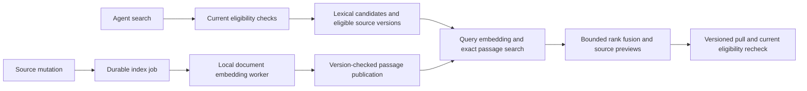

# Persistent semantic retrieval

This optional backend stores local passage embeddings in PostgreSQL. Its purpose
is to make relevant prior guidance discoverable when an agent uses different
words and the eligible collection exceeds the request-scoring worker's 64-note
limit. Deployment and improvement in real agent tasks require separate evidence.

## Data flow



The compiler retains responsibility for scope, sensitivity, applicability,
authority, mandatory instructions and competing positions. The index receives
eligible optional source versions and returns at most 100 note matches. A match
contains a record ID, version, body hash, similarity and original byte span.
The compiler validates that entire result before using it.

The SQL search joins the eligible versions, hashes and configured model identity
before computing distances. It uses exact cosine distance across the matching
passages, selects the best passage per note, then returns at most 100 notes.
There is no approximate vector index or post-search permission filter. The
compiler's existing 10,000-record scoped scan limit remains.

The compiler loads current sources in batches of 256 within its existing
repeatable-read transaction. It retains every scoped candidate and the same
privacy and applicability checks. Ordinary A/context notes can skip further
database reads only when that snapshot shows no scope authorization, forgotten
dependency, conflict membership or evidence reference. Other sources use the
full eligibility path. Candidate receipt details are written together; a failed
write rolls back the retrieval receipt.

## Derivation and currentness

The persistent semantic schema stores derived state in `semantic_document`,
`semantic_passage` and `semantic_job`. It requires the PostgreSQL `vector`
extension to be available to the installer, and schema initialization creates
the extension when absent. Runtime agents do not receive database credentials or
an embedding-write operation.

A source insert, version change or lifecycle change updates the job queue in
the source transaction and removes old indexed passages. Forgetting excludes
vectors when the payload is excluded; ordinary deletion cascades through the
derived rows. SQL deletion retains the existing limitations for dead tuples,
WAL and backups.

Each indexing attempt has a two-minute lease. It reads the source, embeds outside
the transaction, and locks the current record followed by the job before
publishing. It verifies the lease, active lifecycle, version, body and payload
availability. An edit supersedes unfinished work. A failed attempt is retried
after a persisted delay that increases by five seconds to a maximum of five
minutes. A crashed attempt becomes eligible after lease expiry.

Opening the index schedules missing current documents and documents from another
model identity. The index is rebuildable from current sources. A model change
does not make old vectors eligible for the new query encoder.

Sources without a searchable document under the selected identity are claimed
first. Refreshes of documents that are still searchable wait behind them, so an
edit made during a bulk rebuild is not queued behind the whole population.

### Full rebuild under the selected identity

To re-derive every current document without changing the selection or
restarting the API, an unscoped local operator queues the whole population for
the running indexer:

```sh
printf '{"request_id":"%s","reason":"%s"}' "$(uuidgen)" "full semantic rebuild" |
  cairn semantic-requeue
```

The command reports `eligible`, `queued` and `already_queued`. It names no model.
The indexer embeds each job with its own worker and replaces that source's
document in the transaction that publishes the successor. Existing documents
therefore stay searchable throughout, and coverage never drops. One statement
adds every absent job, so an interrupted call queues all or nothing. A repeated
call adds only the jobs that are missing and leaves pending, leased and
backed-off jobs as they are. If the API stops mid-rebuild, the jobs remain in
place. A stranded lease becomes due again after two minutes, and the restarted
indexer finishes the queue. The rebuild is complete when no job remains and
every current document's `indexed_at` is later than the requeue.

## Model and process ownership

The local CPU model is `BAAI/bge-small-en-v1.5`, served by the staged Rust embed
worker ([package guide](semantic-package.md)). The earlier Python FastEmbed worker
is retired. The embedding worker returns 384-dimensional vectors and original UTF-8 byte
spans. It normally uses 128-token windows with a 96-token stride, including the
final shorter window. For unusually token-dense notes, the stride increases to
cover the whole source within 256 passages. Each passage is checked against the
model's input limit. The model identity is the worker-reported `model_sha256`
derivation identity, separate from the executable hash; the package records the
model, native runtime and source identities it was staged from.

The API owns separate persistent worker processes for query and document
embedding. Background work cannot occupy the query worker. A concurrent query
that finds its worker busy falls back immediately. Indexed search has a
two-second deadline; document exchanges allow up to 90 seconds, below the
two-minute job lease, so maximum-size sources have time to finish.
The API cancels, reaps and joins both workers on shutdown. Workers receive a
restricted environment without the database DSN and use prepared local files.

## Ranking and delivery

New ready persistent searches use `cairn.semantic/19` and
`interleaved-scope-recency/5` through `/8`. They retain up to 100 lexical candidates
and up to 100 dense matches. At each rank, lexical comes first and dense second;
a record already exposed is skipped. Membership in both lists earns no extra
position. If one list ends, the other continues. The lexical channel uses the same distinct-term integer IDF and query-specific
[adjacent-compound matching](index-and-pull.md) as ordinary lexical search.
Its document frequencies include the complete eligible optional cohort, including
zero-match notes and admitted competing positions, but exclude mandatory and
rejected sources. Dense ordering remains cosine score/record ID. Weighted lexical
scores choose positions in the lexical list; they do not become extra scores in
the interleaved list.

Existing entity, failure-signature and quoted-text preferences remain outside
this ordering. Mandatory instructions remain independent of optional ranking.
Within an ordinary tier, each channel's first `k` records is exposed within at
most `2k` positions before packing. Outer preferences, whole conflict groups,
deduplication of equal bodies and context budgets can change delivered positions.
This is candidate exposure, not an applicability or confidence judgment. It can
promote a strong one-channel hit and demote a note favored by both channels.

The four new ranking versions retain the ordinary, literal, failure-signature
and entity preference tiers, respectively, and the existing preview policies of
interleaved `/1` through `/4`. An adjacent spelling match does not satisfy an
exact quoted substring. Neither ranking nor similarity establishes currentness.

Historical `cairn.semantic/16` and `/18` packages retain interleaved `/1` through
`/4` with their original unweighted lexical channel. Historical
`cairn.semantic/15` packages with `hybrid-scope-recency/1` through `/4`
retain reciprocal-rank fusion exactly: each bounded list contributes
`floor(1,000,000 / (60 + rank))`, with ranks starting at one. Replay rejects mixed
schema/ranking contracts; it never applies the new rule to an old receipt.

`discovery.state: ready` means the indexed result passed validation. Its
`coverage.indexed` and `coverage.eligible` report coverage of the eligible source
set. New or changed notes that lack vectors can still appear through lexical
matching. During startup, with no indexed eligible notes, or after a worker or
index failure, the response is labelled `DEGRADED_NO_EMBEDDINGS` and uses lexical
selection. Invalid index output is also discarded as a whole. IDF/compound observations
are applied only after a valid ready result; unavailable, invalid and not-needed
paths retain their earlier lexical fallback contract. The older request-scoring
semantic backend is unchanged.

An entry's `summary_span` addresses the original source excerpt used in its
preview; added omission markers are outside that span.
When available, `match_span` addresses the complete scored passage and can be
used as a bounded pull span. Class C instructions and marked competing positions
require whole pulls and do not expose partial-pull hints. A similarity score or
matched passage does not establish relevance or correctness; the consuming agent
must inspect the source before relying on it.

Historical recompile uses retained passage matches and ranking features, without
calling the model or consulting today's vector index. Existing package versions
keep their earlier ranking behavior. Pull still checks current source version
and eligibility, so a formerly valid hit cannot authorize stale delivery.

## Configure and verify

Stage the Rust package, make the extension available, and apply the repository's
normal installer migration before selecting the backend:

```sh
bash scripts/install-semantic.sh --stage-rust ...   # see docs/semantic-package.md
cairn migrate
cairn serve --semantic-rust-config /absolute/path/semantic-rust-embed.json
```

Use the installation's existing database and identity configuration. Staging
does not change a running service. Choose one of `--embedding-command` (an
executable implementing the embedding protocol, such as a staged `embed`
launcher), `--semantic-command`, `--semantic-stream-command` or the explicit
[`--semantic-rust-config` selection](semantic-worker-comparison.md#rust-workers-through-go);
they cannot be combined. Rust mode `embed` uses the same asynchronous index owner
and separate query/document processes. No worker is selected by default, and no
mode falls back to another worker. A missing or invalid worker configuration or
executable stops `cairn serve` at startup. If the selected worker fails at run
time, semantic discovery reports itself unavailable, search returns labelled
lexical results and the API logs
`semantic indexing unavailable; lexical retrieval remains available`.
`--semantic-idle-timeout` applies only to the request-scoring stream worker.

The existing search interface remains:

```sh
cairn agent --token-file "$HOME/.local/share/cairn/hosted-agent.token" search \
  --repo "/projects/shared-memory" --task retrieval-check --run retrieval-check-1 \
  --semantic 'Where should persistent storage live?'
```

Read `discovery.state` and coverage, then inspect the returned source through its
pull arguments. Model unavailability does not imply an empty collection.
To disable this backend, remove its serve flag and restart the same API build;
retained receipts and lexical operation remain supported. Do not drop derivation
tables or roll back migrations as an ordinary configuration change.

`cairn.semantic/19` seals the IDF cohort, frequencies and integer scores
alongside the existing dense digest and passage observations. Recompile verifies
both without a model call. A same-request retry retains the sealed ranking and
preview policy, while recomputing current eligibility and content and checking
the original intent and exact seal. Changed sources, dense output or
availability can still return `STALE_PACKAGE`; use a new request ID for current
results. Unknown ranking versions refuse replay, and older readers cannot
replay `cairn.semantic/19` receipts.
