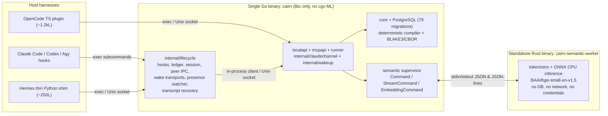
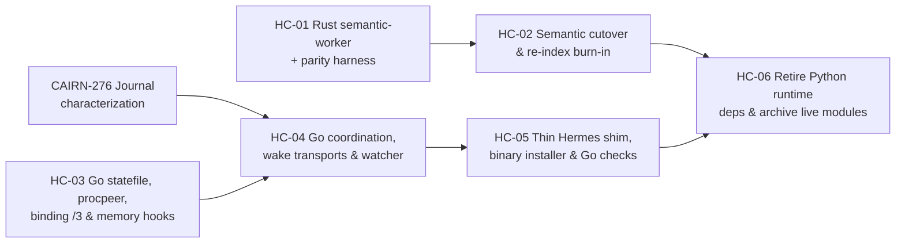

# Hybrid runtime consolidation plan

Status: architecture and staged implementation plan recorded on 2026-11-06.
Planning baseline `4388ade5256d56bd8bf2fb1ba7c2f027912541d4`. See
[implementation status](../implementation-status.md) for current source
behavior, [architecture](../developer/architecture.md) for active component
boundaries, [installed lifecycle bundles](../lifecycle-bundles.md) for the
current Python installation closure, and
[persistent semantic retrieval](../persistent-semantic-retrieval.md) for the
current embedding worker contract. This document specifies a staged runtime
consolidation; it does not claim that the Go lifecycle subcommands or the Rust
semantic worker are implemented yet.

The [organization, implementation sequence, and lead prompts](hybrid-runtime-implementation.md)
provide the execution plan, including current-source corrections to the semantic
cutover and command compatibility assumptions below.

## Summary and decision

Cairn currently splits live host runtime behavior across a single statically
compiled Go binary (`cairn`, linking dynamically only to `libc`), two Python
subsystems (`integrations/lifecycle/` and `scripts/*semantic*` /
`scripts/embedding_worker.py`), and small host-mandated adapter shims for
OpenCode (`integrations/opencode/*.ts`), Hermes (`integrations/hermes/*.py`),
and an experimental Node V8 custody addon (`integrations/sdk-ipc/`).

Instead of rewriting the Go store and API contract in Rust or pulling C++/Rust
ONNX bindings into the Go binary via `cgo`, Cairn will consolidate onto a
two-binary hybrid architecture plus irreducible in-process host shims:

1. **Go owns the operational plane (`cairn`).** Keep PostgreSQL storage,
   migrations, deterministic compilation, CBOR+BLAKE3 package sealing, the
   source-derived OpenAPI 3.1 contract, the local HTTP/Unix-socket daemon, MCP
   stdio facades, `runner`, `internal/wakeup`, and `semantic` worker
   supervision in Go with `CGO_ENABLED=0` behavior preserved (no C/C++/Rust FFI
   inside `cairn`). Absorb the 17 production modules under
   `integrations/lifecycle/` (13,308 lines) into internal Go packages exposed
   through the existing `cairn` executable.
2. **Rust owns the isolated CPU inference worker (`cairn-semantic-worker`).**
   Replace `scripts/semantic_rank.py`, `scripts/embedding_worker.py`, and the
   ~250–400 MB `.venv-semantic` Python/FastEmbed/NumPy/ONNX Runtime virtual
   environment with a single standalone Rust binary behind the existing
   stdin/stdout JSON and JSON-line contracts in `semantic/command.go`,
   `semantic/stream.go`, and `semantic/embedding_command.go`.
3. **Host-mandated plugin shims stay minimal; historical trial code stays
   frozen.** OpenCode (`@opencode-ai/plugin` TypeScript) and Hermes (in-process
   Python `MemoryProvider` and hook entrypoints) retain only thin adapters that
   delegate policy, locking, slicing, and API calls to `cairn`. Frozen Python
   evaluation harnesses (`scripts/trial_*`, ~90,000 lines) remain untouched so
   historical pins and two-file or `/2` bundle receipts stay reproducible.



## Current runtime baseline and rejected alternatives

At the planning baseline (`4388ade5256d56bd8bf2fb1ba7c2f027912541d4`), the
repository splits across four implementation languages plus SQL and web assets:

| Surface | Production size | Test size | Current role |
| --- | --- | --- | --- |
| Go (`core/`, `localapi/`, `mcpapi/`, `cmd/cairn/`, `semantic/`, `runner/`, `artifacts/`, `internal/`) | 67,091 lines (247 files) | 92,908 lines (373 files) | Operational store, HTTP/Unix API, MCP servers, CLI, runner, wakeup supervisor, semantic process supervisor |
| SQL (`core/migrations/001`–`079`) | 2,299 lines (79 files) | Covered by `make test-integration` | Forward-only PostgreSQL schema and constraints |
| Python lifecycle (`integrations/lifecycle/`) | 13,308 lines (17 files) | 1,178 lines (7 files) + integration scripts | Harness hooks (`SessionStart`, `UserPromptSubmit`, `PreCompact`, `Stop`), presence watcher, wake transports, grant ledger, transcript recovery |
| Python semantic workers (`scripts/*semantic*`, `scripts/embedding_worker.py`) | ~700 lines (4 files) | Covered by Go/Python semantic checks | FastEmbed / `tokenizers` / ONNX Runtime CPU ranking and passage embedding |
| Python Hermes plugin (`integrations/hermes/`) | 1,244 lines (5 files) | 1,039 lines (1 file) | In-process Hermes `MemoryProvider`, hook handlers, dialogue slicing, coordination bridge |
| Python black-box checks (`scripts/check_*.py`, `verify_docs.py`) | ~27,600 lines | Self-testing | Disposable-cluster integration checks and repository verification |
| Python frozen trials (`scripts/trial_*.py`, `test_trial_*.py`) | ~90,000 lines | Included | Historical capability, replay, and weekly evaluation harnesses |
| TypeScript (`integrations/opencode/*.ts`) | 1,176 lines (4 files) | 1,288 lines (3 files) | In-process OpenCode plugin (`@opencode-ai/plugin` + `zod`) |
| C + Node CommonJS (`integrations/sdk-ipc/`, `scripts/*sdk*.cjs`) | 637 C/H + 2,341 JS lines | 1,132 JS lines | Experimental V8 isolate / `pidfd` / `SOCK_SEQPACKET` custody trial |

### Operational friction in the current split

1. **Duplicate systems primitives across Go and Python.** Go already implements
   `LockedStateFile[T]` (`cmd/cairn/locked_state_file.go`, `flock(LOCK_EX)` +
   `0600` temp-file rename + parent-directory sync), `ProcessRef` reading
   `/proc/<pid>/stat` start ticks and `/proc/sys/kernel/random/boot_id`
   (`internal/claudechannel/claudechannel.go`), `SO_PEERCRED` socket checks, and
   `systemd` fresh-work inbox supervision (`internal/wakeup`). Python
   reimplements all four across `integrations/lifecycle/unix_peer_transport.py`,
   `claude_channel.py`, `native_session.py`, `grant_ledger.py`, and
   `coordination.py`.
2. **Multi-file Python installation closures and subprocess chains.** A 2026-10-26
   probe found that partial file copying let installed hooks import helpers from
   a development checkout. `integrations/lifecycle/lifecycle_bundle.py` closed
   that gap with immutable 17-file snapshot directories, private module loading,
   and `cairn.inbox-recall-binding/2` sidecar pins, at the cost of bespoke
   loader machinery. In addition, every Python hook invocation pays ~40–90 ms
   of interpreter startup and spawns `cairn agent ...` subprocesses instead of
   talking directly to the Unix-domain API socket inside a single binary.
3. **Host Python dependency drift.** `integrations/lifecycle/codex_queue.py`
   depends on system `python3-websocket` (`import websocket`), while semantic
   indexing depends on `.venv-semantic` (`fastembed==0.8.0`, `onnxruntime`,
   `tokenizers`, `numpy`) provisioned via `scripts/install-semantic.sh`. Python
   minor-version upgrades on the host can break virtual environments or missing
   system packages independently of `cairn`.
4. **Sequential black-box integration runtime.** Spawning Python interpreters and
   subprocesses across `scripts/check_*.py` pushes `make test-integration` to
   roughly 24 minutes (~1,455 s).

### Why an all-Go ML port was rejected

Go has no mature pure-Go library that matches HuggingFace `tokenizers` fast
WordPiece/BPE offset mapping plus SIMD-accelerated ONNX CPU execution for
`BAAI/bge-small-en-v1.5`. Embedding `onnxruntime_go` and `tokenizers` into
`cairn` requires `cgo` plus dynamic `.so` or static C++/Rust archives, breaking
`cairn`'s clean pure-Go build (`go test`, fast cross-worktree compilation, no
`LD_LIBRARY_PATH` distribution rules) and placing C++/FFI memory safety inside
the privileged store/API binary. Keeping the Go supervisor boundary in
`semantic/` and replacing only the Python child process with a standalone Rust
executable avoids every `cgo` drawback while eliminating `.venv-semantic`.

### Why a full-Rust rewrite of the Go core was rejected

Rewriting ~160,000 lines of Go production and test code offers low operational
return and high regression risk:

- **Contract coupling to Go's type and JSON semantics.** `internal/apicontract`
  uses `go/ast` and `go/types` over `localapi.OperationCatalog()` and `core`
  structs to generate the 102,429-line `docs/api/openapi.json` specification,
  explicitly encoding Go `encoding/json` accepted versus canonical wire shapes
  (case-insensitive field fallback, integer-valued float rejection, UTF-16
  surrogate / noncharacter handling in `internal/jsontext`). Recreating exact
  wire parity in `serde_json` + `utoipa`/`schemars` is high-risk churn with no
  user-visible benefit.
- **Cryptographic byte-for-byte sealing invariants.** `core/compiler.go` and
  `core/recompile.go` seal deterministic execution packages with canonical CBOR
  (`fxamacker/cbor/v2`) and BLAKE3 digests stored in PostgreSQL and verified on
  replay. Any serialization divergence invalidates historical package hashes.
- **Database-bound latency and multi-worktree build cost.** `cairn serve`
  throughput is dominated by PostgreSQL transactions (`pgx/v5`) and Unix socket
  I/O, not Go GC pauses. Parallel autonomous worktrees (`git-wt`) rely on near-
  instant incremental `go test`; a 160k-line Rust workspace with heavy proc-macro
  crates (`sqlx`, `serde`, `tokio`) multiplies per-worktree compile times and
  `target/` disk usage.

## Track A: Go lifecycle and coordination consolidation

Track A absorbs all 17 production modules in `integrations/lifecycle/` (13,308
lines) into internal Go packages linked into the existing `cairn` binary. Host
hooks (`SessionStart`, `UserPromptSubmit`, `PreCompact`, `Stop`), the `systemd`
presence watcher (`cairn-presence.service`), and explicit recovery subcommands
invoke the compiled Go binary directly instead of starting `python3` over an
installed snapshot directory.

### Package mapping and reuse of existing Go primitives

| Current Python module(s) | Lines | Target Go package | Existing Go code reused or unified |
| --- | --- | --- | --- |
| `lifecycle_bundle.py`, `inbox_binding.py` | 331 | `internal/lifecycle/binding` | `internal/buildinfo`; binary SHA-256 replaces 17-file snapshot loader while retaining `/2` pin validation during coexistence |
| `unix_peer_transport.py`, `process_scan.py`, `claude_channel.py` | 534 | `internal/procpeer` (extracted from `internal/claudechannel`) | `internal/claudechannel.ProcessRef`, `/proc/<pid>/stat` tick parsing, `boot_id`, `SO_PEERCRED`, `0700` runtime socket rules |
| `grant_ledger.py`, `native_session.py` | 1,085 | `internal/lifecycle/ledger`, `internal/lifecycle/session` | Promote `LockedStateFile[T]` from `cmd/cairn/locked_state_file.go` into `internal/statefile` (`flock(LOCK_EX)`, `0600`, atomic rename + dir sync) |
| `hook_admission.py`, `recall_dispatch.py` | 511 | `internal/lifecycle/admission` | `localapi.Client` Unix-socket transport, `internal/refusal` durable refusal envelopes |
| `memory.py`, `inbox_recall.py` | 4,237 | `internal/lifecycle/recall`, `internal/lifecycle/capture` | Direct `localapi.Client` calls (`Search`, `Pull`, `Remember`, `ClientObserve`) without spawning child CLI processes |
| `wake_transport.py`, `codex_queue.py`, `opencode_queue.py`, `hermes_queue.py` | 1,356 | `internal/lifecycle/waketransport` | Pure-Go WebSocket framing over peer-verified Unix sockets for Codex (removing `python3-websocket`); peer-verified Unix-socket JSON-RPC (`prompt_idle` + native cancel) for OpenCode; `internal/procpeer` frames for Claude and Hermes |
| `transcript_recovery.py` | 739 | `internal/lifecycle/transcript` | Streaming `bufio.Reader` + `internal/jsontext` strict JSONL verification for Codex, Claude, and OpenCode session logs |
| `coordination.py` | 4,515 | `internal/lifecycle/journal`, `internal/lifecycle/presence`, `internal/lifecycle/recovery` | Explicit inbox journal execution owner (aligned with CAIRN-276..278), `localapi.Client` event watch/ack/complete calls, `internal/wakeup` patterns |

### Prerequisite: inbox journal characterization before translation

`coordination.py` currently mixes hook delivery, inbox journal state transitions,
watcher liveness heartbeats (`WATCH_INTERVAL = 30s`, `CANCEL_POLL_INTERVAL = 2s`),
and nine recovery/inspection entrypoints in one 4,515-line module. Translating
that file line-for-line into Go would freeze incidental Python branching before
its edge cases are explicitly specified.

Track A therefore sequences its coordination port behind the existing
characterization gate (CAIRN-276 through CAIRN-278):

1. Capture golden black-box fixtures covering ordinary explicit retries through
   the authenticated API versus watcher pending-only recovery, `flock` lock
   waits and timeouts, exact reply references, on-disk journal JSON schemas,
   `NativeSession` custody transitions, and the `settled_journal_index` /
   `finish_reply` materialization boundary.
2. Implement the extracted journal execution owner once in
   `internal/lifecycle/journal` against those fixtures rather than refactoring
   `coordination.py` twice.

### Proposed CLI grammar and in-process transport

Installed hook configurations will invoke subcommands under a dedicated
`lifecycle` group on the `cairn` executable:

```text
cairn lifecycle memory --harness <claude|codex|opencode|agy|hermes> --event <SessionStart|UserPromptSubmit|PreCompact|Stop> [--config <path>]
cairn lifecycle coordination hook --harness <claude|codex|opencode|agy|hermes> --event <event> [--config <path>]
cairn lifecycle coordination watch --config <path>
cairn lifecycle coordination recover --mode <refused-wake|native-refused-wake|codex-refused-wake|codex-ended-turn|daemon-start-claim> --config <path>
cairn lifecycle coordination check-codex-native-health --config <path>
cairn lifecycle coordination reconcile-codex-queue-wake --config <path>
cairn lifecycle coordination inspect-held-refusal --config <path>
```

Today `memory.py` and `coordination.py` invoke `cairn agent ...` subprocesses up
to four times per hook event (`search`, `pull`, `remember`, `client-observe`)
and set `CAIRN_CALLER_DIAGNOSTICS` in the child environment to record meter
telemetry (`cairn-lifecycle/recall-meter/1` and `cairn-lifecycle/capture-meter/2`).
Inside Go, `internal/lifecycle` calls `localapi.Client` directly over the
configured Unix socket:

- **Eliminated subprocess hops.** Removing Python startup plus 1–4 child CLI
  spawns cuts per-turn `UserPromptSubmit` and `SessionStart` overhead from
  ~60–150 ms to <5 ms of local client framing inside the 13-second host hook
  timeout (`RECALL_SECONDS = 11`, `CONTEXT_BYTES = 12000`).
- **Preserved caller diagnostics and attribution.** `localapi.Client` already
  attaches caller observation headers from `CallerOrigin`; `internal/lifecycle`
  populates the exact `implementation_id` (SHA-256 of the running `/proc/self/exe`
  binary) and meter schemas (`cairn-lifecycle/recall-meter/1`,
  `cairn-lifecycle/capture-meter/2`) on the outbound Unix-socket request without
  environment-variable indirection. Store-owned token authentication and
  principal attribution remain enforced exclusively by `cairn serve`.

### Harness exit-code, stdio, and refusal contracts

Host harnesses treat hook stdout, stderr, and exit codes as control-plane
signals. `internal/lifecycle` must preserve byte-level behavioral parity across
every supported harness:

- **UserPromptSubmit required-context and prompt refusals.** When recall hits
  `RequiredContextRefused` or coordination hits `NativePromptRefused`, the hook
  writes the refusal reason to stderr and exits `2` so Claude Code and Codex
  abort prompt submission cleanly without corrupting transcript state.
- **Codex SessionStart refusal envelope.** On Codex `SessionStart`,
  `RequiredContextRefused` writes `{"continue": false, "stopReason": "<reason>"}`
  to stdout and exits `0`, matching Codex's session-start hook contract.
- **Ordinary degraded recall.** When `cairn serve` is unreachable or times out
  and no required-instruction gate is tripped, non-required recall degrades
  open with bounded diagnostic logging and exit `0`, never blocking interactive
  turns on optional context.
- **Strict stdin bounds and process-ancestry checks.** Hook stdin reads remain
  capped and parsed strictly (rejecting trailing tokens and invalid UTF-8/UTF-16
  surrogates via `internal/jsontext`). Linux peer verification in
  `internal/procpeer` enforces UID match via `SO_PEERCRED`, verifies `(pid,
  start_ticks, boot_id)` from `/proc/<pid>/stat` and
  `/proc/sys/kernel/random/boot_id`, and walks parent PIDs (`caller_descends_from`)
  before accepting local wake or session-registration frames.

### Local wake-transport contracts and presence-watcher supervision

All four local wake transports ride on `internal/procpeer` over owner-only
(`0700` directory) Unix-domain sockets verified via `SO_PEERCRED` plus
`(pid, start_ticks, boot_id)` before any payload is written:

| Harness | Wire framing over verified `net.UnixConn` | Busy, refusal, and cancellation semantics |
| --- | --- | --- |
| Codex (`codex_queue.py`) | WebSocket client upgrade (`Custom Dial` over pre-verified Unix socket) + JSON-RPC `{id, method, params}`; ignores server-initiated frames carrying `"method"` | Error code `-32600` (`"thread already has an active or pending turn"`) treated as `busy_ok` (existing turn keeps ownership); other JSON-RPC errors surface `QueueRefused` |
| OpenCode (`opencode_queue.py`) | Bounded peer-socket JSON-RPC (`prompt_idle` and native request cancellation with `CANCEL_TIMEOUT = 35s`) | `-32600` maps to atomic `QueueUnavailable` busy; cancel error codes (`-32601`, `-32004`, `-32602`, etc.) map deterministically to `CancelRefused` reasons versus `CancelUncertain` |
| Claude Code (`claude_channel.py`) | Single-line JSON (`<= 8192` bytes, 2s read/write deadline) to `cairn claude-channel` (`cairn.claude-channel/1`) | Bridge emits `notifications/claude/channel` over legacy MCP initialize, answering `server/discover` as pre-sessionless so Claude 2.1.282+ delivers unsolicited wakes |
| Hermes (`hermes_queue.py`) | Bounded peer-socket JSON request/ack to the in-process Hermes session listener | Distinguishes pre-admission socket unavailability from explicit native queue refusal |

For `cairn-presence.service` (`watch` mode, `WATCH_INTERVAL = 30s`,
`CANCEL_POLL_INTERVAL = 2s`), the Go daemon handles `SIGINT`/`SIGTERM` via
`signal.NotifyContext`: in-flight `internal/statefile` atomic renames complete
before releasing `flock(LOCK_EX)`, preventing torn journal updates during
`systemctl --user restart cairn-presence.service`.

### Binary binding pins and coexistence with `lifecycle-bundle.json`

[Installed lifecycle bundles](../lifecycle-bundles.md) introduced
`lifecycle-bundle.json` and `cairn.inbox-recall-binding/2` so Python hooks never
resolve helper modules from a working checkout. Consolidating into `cairn`
replaces a 17-file snapshot closure with one immutable ELF binary, while
preserving the same staging and replacement rules:

1. **Stage immutable binary snapshots per installation.** Rather than pointing
   installed hook configs at a mutable `$GOPATH/bin/cairn` or checkout build,
   the lifecycle installer copies (or hard-links inside the same owner-only
   filesystem) the verified `cairn` binary into an immutable versioned path
   under `$HOME/.local/share/cairn/lifecycle/bin/cairn-<sha256>` (`0755` in an
   `0700` directory) alongside an installation receipt recording `binary_sha256`
   and Go build info.
2. **Introduce `cairn.inbox-recall-binding/3` alongside `/2`.** Binding schema
   `/3` keeps the exact `enabled`, `memory_config` (`{path, sha256}` with
   `recall_mode: "agent_tools"` and `1000 <= context_bytes <= 9500`), and `1..8`
   `coordination_configs` checks from `inbox_binding.py`, replacing the `/2`
   Python `bridge` and `engine` snapshot descriptors with a single `binary` pin
   verified against `/proc/self/exe`:

```json
{
  "schema": "cairn.inbox-recall-binding/3",
  "enabled": true,
  "binary": {
    "path": "/var/lib/cairn-user/lifecycle/bin/cairn-9f86d081884c7d659a2feaa0c55ad015a3bf4f1b2b0b822cd15d6c15b0f00a08",
    "sha256": "9f86d081884c7d659a2feaa0c55ad015a3bf4f1b2b0b822cd15d6c15b0f00a08"
  },
  "memory_config": {
    "path": "/var/lib/cairn-user/lifecycle/claude/memory.json",
    "sha256": "4b227777d4dd1fc61c6f884f48641d02b4d121d3fd328cb08b5531fcacdabf8a"
  },
  "coordination_configs": [
    {
      "path": "/var/lib/cairn-user/lifecycle/claude/coordination.json",
      "sha256": "ef2d127de37b942baad06145e54b0c619a1f22327b2ebbcfbec78f5564afe39d"
    }
  ]
}
```

   Both `/2` (Python 17-file bundle) and `/3` (Go single binary) remain valid
   during migration so individual harnesses can cut over one at a time.
3. **Preserve state files and refuse live replacement.** On-disk JSON schemas
   for grant ledgers, `NativeSession` state, inbox journals, and wake registries
   stay unchanged across Python and Go implementations. Installers continue to
   refuse in-place replacement while a binding is enabled: cutover requires
   explicit drain, restage, repin, and `cairn-presence.service` restart.
   Historical weekly two-blob trials and `/2` bundle trials remain pinned to
   their frozen Python snapshots.

## Track B: Standalone Rust semantic and embedding worker

Track B replaces `scripts/semantic_rank.py`, `scripts/embedding_worker.py`, and
the `.venv-semantic` Python virtual environment with a standalone Rust binary,
`cairn-semantic-worker`, built from a self-contained Cargo workspace at
`semantic-worker/`. Go packages in `semantic/` (`command.go`, `stream.go`,
`embedding_command.go`, `index.go`, `index_service.go`) keep full ownership of
worker lifecycles, timeouts, process-group reaping (`Setpgid: true` with `-pid`
`SIGKILL`), bounded stdout/stdin pipes, PostgreSQL `cairn.semantic_job` leasing,
and lexical fallback (`DEGRADED_NO_EMBEDDINGS`).

### Sandboxed process boundary and crate selection

`cairn-semantic-worker` runs as an unprivileged child process with no database
DSN, no API socket, no credentials, `Stderr` discarded by the Go supervisor, and
a sanitized environment (`PATH=/usr/bin:/bin`, `HF_HUB_OFFLINE=1`,
`HF_HUB_DISABLE_TELEMETRY=1`, `TOKENIZERS_PARALLELISM=false`). It reads only the
prepared local `BAAI/bge-small-en-v1.5` directory (`model_optimized.onnx` and
`tokenizer.json`) passed via `--model-dir <dir>`.

| Component | Recommended crate | Rationale and build constraints |
| --- | --- | --- |
| Tokenization & offset mapping | `tokenizers` (`default-features = false`, `onig` disabled, pure-Rust regex) | Exact upstream implementation already backing Python `tokenizers`; preserves WordPiece subword splits and byte/char offset spans without C regex dependencies |
| ONNX CPU execution | `ort` (statically or bundle-linked CPU execution provider, single/bounded intra-op threads) | Matches Python `onnxruntime` operator kernels on `model_optimized.onnx` within floating-point rounding (`<= 1e-6` cosine difference); pure-Rust `candle` remains a fallback option only if static `libonnxruntime` packaging proves awkward on a target Linux architecture |
| Wire framing & hashing | `serde`, `serde_json`, `sha2`, `base64` | Streaming line-delimited JSON over buffered `StdinLock`/`StdoutLock` with explicit per-line byte caps matching Go |

Isolating the Rust crate under `semantic-worker/` keeps Go builds completely
independent: `go test ./...` and `make check` never invoke `cargo` unless files
under `semantic-worker/` change or semantic worker parity targets run.

### Preserved wire contracts across all three Go supervisor modes

One binary supports all three mutually exclusive `cairn serve` flags
(`--semantic-command`, `--semantic-stream-command`, and `--embedding-command`)
via explicit CLI mode flags:

1. **One-shot ranker (`cairn-semantic-worker rank --model-dir <dir>`).** Matches
   `semantic.Command` (`semantic/command.go`):
   - Reads one `SemanticRankRequest` JSON document from stdin (`1..64` notes,
     `<= 1 MiB` total body bytes, `<= 4096` byte query, `body_sha256` verified
     against UTF-8 `body` bytes) within the 25-second Go supervisor deadline.
   - Emits one `SemanticRankResult` JSON document (`<= 64 KiB`,
     `algorithm: "bge-max-chunk/1"`, integer scores scaled by
     `round(clamp(sim, -1.0, 1.0) * 1_000_000)`) and exits `0`.
2. **Persistent stream ranker (`cairn-semantic-worker rank --stream --model-dir <dir>`).**
   Matches `semantic.StreamCommand` (`semantic/stream.go`):
   - Loads the tokenizer and ONNX session once; processes newline-delimited
     `{id, request, cache?}` frames and flushes `{id, result, cache?}` lines
     with echo-verified `id` values across the 30-second default idle window.
   - When `CAIRN_SEMANTIC_STREAM_CACHE=1` is set in the worker environment,
     validates and emits `cairn.passage-vectors/1` cache snapshots (`<= 128`
     entries, little-endian float32 `<f4` base64 vectors, `<= 600 KiB`).
3. **Persistent passage index worker (`cairn-semantic-worker embed --model-dir <dir>`).**
   Matches `semantic.EmbeddingCommand` (`semantic/embedding_command.go`) across
   both persistent worker processes spawned by `semantic.OpenIndex` (the
   low-latency `query` lane with a 25s worker timeout / 2s `Index.Search` budget
   and the background `document` lane with a 90s worker timeout inside a
   2-minute `cairn.semantic_job` SQL lease):
   - Accepts newline-delimited `{"id", "operation", "text"}` requests (`<= 512 KiB`,
     `1 <= len(id) <= 128`, rejecting unknown keys) for `operation` in
     `"identity"` (`text == ""`), `"query"` (`<= 4096` UTF-8 bytes), and
     `"document"` (`<= 65536` UTF-8 bytes).
   - Emits compact newline-delimited JSON responses (`<= 4 MiB`, `allow_nan=false`)
     carrying `identity` (`model_sha256`, `algorithm: "bge-original-passages/1"`,
     `dimensions: 384`), `vector` + `query_projection` (`method: "original-prefix/1"`,
     `truncated`, `original_tokens`, `embedded_tokens`, `prefix_bytes`,
     `prefix_sha256`) for queries, and `passages` (`[{"span": {"offset", "length"}, "vector": [...]}]`,
     where `semantic/index.go` assigns `passage_index` from slice order) for
     documents:

```json
{
  "id": "req-01",
  "identity": {
    "model_sha256": "3b9c8e5b27f81a9e4d12f0c7a6e9831b4c2d5e6f7a8b9c0d1e2f3a4b5c6d7e8f",
    "algorithm": "bge-original-passages/1",
    "dimensions": 384
  },
  "query_projection": {
    "method": "original-prefix/1",
    "truncated": false,
    "original_tokens": 19,
    "embedded_tokens": 19,
    "prefix_bytes": 42,
    "prefix_sha256": "73475cb40a568e8da8a045ced110137e159f890ac4da883b6b17dc651b3a8049"
  },
  "vector": [0.041259, -0.018934]
}
```

### Tokenization, passage-slicing, and numerical parity invariants

`semantic/index.go` validates every returned passage span and vector before
committing to `cairn.semantic_document` and `cairn.semantic_passage`.
`cairn-semantic-worker` must preserve the exact invariants currently enforced
between `scripts/embedding_worker.py`, `scripts/semantic_rank.py`, and Go:

- **Query prefix and truncation retreat (`embed` mode).** Prepend
  `"Represent this sentence for searching relevant passages: "` to the query.
  Disable implicit tokenizer truncation and padding (`no_truncation()`,
  `no_padding()`) over raw text first to read exact token offsets. When the
  prefixed query exceeds `512` tokens, start at token cut `end = 511`, find the
  furthest non-empty offset `last` in `offsets[:end]`, slice `prefix` from the
  original query text (`last - len(PREFIX)`), and retreat `end` up to 8
  iterations (`end -= max(1, embedded_tokens - 512)`) until re-encoding
  `PREFIX + prefix` fits within `<= 512` tokens, refusing if no bounded non-empty
  prefix fits.
- **Complete, bounded document passage coverage (`embed` mode).** Tokenize raw
  UTF-8 documents (`<= 65536` bytes) with `add_special_tokens = false`,
  `WINDOW = 128`, `STRIDE = 96`, adaptive `stride = max(96, (len(offsets) + 255) / 256)`,
  and `window = max(128, stride + 32)`. Each window slices `body[first:last]`
  from the first to the last token offset in the window (retaining the final
  smaller window so earlier prefix text does not drown a short trailing
  decision), checks `len(encode(passage).ids) <= 512`, and emits `1..256` spans
  addressed in UTF-8 byte `{offset, length}`. Because Rust `tokenizers`
  `Encoding::get_offsets()` already indexes UTF-8 bytes on `&str` (whereas
  Python `tokenizers` indexed Unicode scalars and re-encoded prefixes), a
  multi-byte UTF-8 golden fixture (CJK, emoji, combining marks) verifies
  byte-exact `{offset, length}` equality between Python and Rust.
- **Batch-size-1 inference, CPU thread bounds, and L2 normalization.** Configure
  the ONNX session with explicit thread caps (`intra_op_threads = 1` or bounded
  `CAIRN_SEMANTIC_THREADS`, `inter_op_threads = 1`, `TOKENIZERS_PARALLELISM=false`)
  so two persistent workers (`query` + `document`) never contend on OpenMP spin
  pools across multi-core hosts. Run inference with batch size `1` (matching
  `model.embed(texts, batch_size=1)` in Python) so sequence padding never shifts
  hidden states, check every float32 component is finite with L2 norm `> 0`, and
  normalize to unit length (`||v||_2` within `[0.99, 1.01]` as checked by Go).
- **Ranker chunking (`rank` mode) and multi-worktree Cargo cache.** Preserve
  `WINDOW = 384` tokens, `STRIDE = 320` tokens, and `MAX_CHUNKS = 128` per note
  for `algorithm: "bge-max-chunk/1"`. Build scripts under `scripts/` default
  `CARGO_TARGET_DIR` to `$HOME/.cache/cairn-build/semantic-worker-target` when
  unset so parallel `git-wt` worktrees share compiled Rust dependencies instead
  of duplicating multi-gigabyte `target/` trees per branch.

### Derivation identity and zero-downtime re-indexing

`embedding_worker.py` computes `model_sha256` by hashing `model_optimized.onnx`,
`tokenizer.json`, package versions, and algorithm constants. `cairn-semantic-worker`
will compute `model_sha256` over:

1. Exact SHA-256 digests of `model_optimized.onnx` and `tokenizer.json`;
2. The `cairn.rust-embedding-worker/1` derivation tag, `ort` / `tokenizers`
   locked versions recorded at compile time, and algorithm parameters
   (`bge-original-passages/1`, `384`, `128`, `96`, `256`).

Because `cairn-semantic-worker`'s `model_sha256` intentionally differs from the
Python worker's `model_sha256`, switching `--embedding-command` on `cairn serve`
triggers the existing background re-indexing loop in `semantic.OpenIndex`
(`semantic/index.go`): `enqueueMissing` selects active eligible records lacking
a `cairn.semantic_document` row for the active `model_sha256`, enqueues
`cairn.semantic_job` items, serves lexical fallback (`DEGRADED_NO_EMBEDDINGS`)
for not-yet-reindexed records without blocking reads or writes, and garbage-
collects superseded `model_sha256` rows once jobs drain. Rolling back
`--embedding-command` to Python follows the exact same safe re-derivation path.

## Track C: Host adapter shims, SDK-IPC policy, and test-suite consolidation

### Irreducible in-process host shims

Two supported clients load plugins inside their own language runtimes rather
than invoking external shell hooks for every event:

- **Hermes (`integrations/hermes/`, currently 1,244 lines across 5 Python files).**
  Hermes imports a Python `MemoryProvider` subclass and registers in-process
  callbacks (`register(ctx)`). The in-process Python surface cannot be zero,
  but ~80% of its current code (dialogue slicing, `flock` control-file locking,
  session-inbox socket listener management, and CLI argument assembly) belongs
  inside the Go `lifecycle` subcommands. Track C shrinks `integrations/hermes/`
  to a ~200–300 line pure-stdlib forwarding shim that translates Hermes hook
  objects into one staged-binary call or Unix-socket request.
- **OpenCode (`integrations/opencode/*.ts`, 1,176 lines across 4 TypeScript files).**
  OpenCode plugins run inside Bun/Node against `@opencode-ai/plugin` and `zod`
  tool schemas. `integrations/opencode/` already delegates memory and
  coordination operations to `cairn`; keep it in TypeScript and switch any
  lifecycle helper invocations from Python snapshots to the staged `cairn`
  binary.
- **Browser work view (`web/workview/`).** Already embedded into `cairn` via Go
  `embed.FS`; unchanged.

### Node SDK custody addon (`integrations/sdk-ipc/`)

`integrations/sdk-ipc/binding.c` (637 lines of C/H) implements a Linux V8/Node
N-API native addon (`prctl(PR_SET_DUMPABLE, 0)`, `pidfd`, `SOCK_SEQPACKET` peer
verification, isolate-pinned handles) paired with `scripts/*sdk*.cjs` (2,341
lines) for SDK custody trials.

- **Default rule:** Leave `integrations/sdk-ipc/` untouched while the Node SDK
  custody path remains an experimental/trial surface.
- **Promotion trigger:** If the Node SDK custody route is promoted to a
  supported production client interface, replace `binding.c` with a small Rust
  `napi-rs` cdylib crate sharing Linux peer-identity constants rather than
  expanding handwritten C/N-API code.

### Frozen evaluation trials versus live integration checks

- **Keep `scripts/trial_*` and `scripts/test_trial_*` (~90,000 lines) frozen in
  Python.** Historical trial runners verify dated claims, replay pins, and
  two-file versus `/2` bundle refusal rules. Rewriting them in Go would risk
  invalidating historical reproducibility with zero runtime benefit.
- **Selectively migrate slow `scripts/check_*.py` harnesses into Go tests.**
  Keep `scripts/verify_docs.py` (fast static check, ~1–2 s) and lightweight CLI
  smoke scripts as-is, while migrating process-heavy lifecycle, coordination,
  and semantic black-box checks into parallelizable Go integration tests using
  in-process `localapi` servers and shared disposable PostgreSQL templates. This
  targets cutting `make test-integration` wall-clock time from ~24 minutes
  (~1,455 s) by eliminating repeated Python + subprocess startup loops.

## Staged delivery sequence and dependencies

Track B (`cairn-semantic-worker`) and Track A (`internal/lifecycle`) share no
source files and can proceed in parallel in isolated `git-wt` worktrees. Within
Track A, shared primitives and memory hooks ship before inbox coordination,
which waits on the CAIRN-276 characterization fixture gate.

| Slice | Complete deliverable | Predecessors | Primary verification gate |
| --- | --- | --- | --- |
| HC-01 | `semantic-worker/` Rust crate (`rank`, `rank --stream`, `embed`), `scripts/install-semantic.sh` model-only + binary staging mode, numerical and ranking parity harness | None | Multi-byte UTF-8 span golden tests, cosine parity (`<= 1e-6` vs Python ONNX), `compare_semantic_workers.py` ranking parity on `core/testdata/retrieval-quality.json`, `go test ./semantic/...` against Rust binary |
| HC-02 | Cut over default `--embedding-command` / `--semantic-stream-command` installer configuration to `cairn-semantic-worker`; retain Python scripts as explicit fallback until one full re-index cycle completes | HC-01 | Disposable PostgreSQL `OpenIndex` migration from Python `model_sha256` to Rust `model_sha256`, `DEGRADED_NO_EMBEDDINGS` fallback under worker kill/timeout, rollback test |
| HC-03 | Shared Go lifecycle foundation (`internal/statefile`, `internal/procpeer`, `internal/lifecycle/binding` with `/2` + `/3` pin support, `internal/lifecycle/ledger`, `internal/lifecycle/admission`) and memory hooks (`SessionStart`, `UserPromptSubmit`, `PreCompact`, `Stop`) | None | Byte-identical exit codes, stdout/stderr, and refusal envelopes across Claude, Codex, OpenCode, Agy, and Hermes fixtures; direct `localapi.Client` meter parity (`recall-meter/1`, `capture-meter/2`) |
| HC-04 | Inbox journal characterization fixtures (CAIRN-276), Go journal execution owner (`internal/lifecycle/journal`), wake transports (including pure-Go Codex WebSocket client), `watch` daemon, transcript recovery, and recovery subcommands | HC-03 and CAIRN-276 characterization | Golden journal transition parity, `SO_PEERCRED` + `ProcessRef` ancestry rejection tests, Codex/Claude/OpenCode/Hermes wake delivery and refusal recovery tests |
| HC-05 | Thin `integrations/hermes/` adapter (~250 lines), staged `cairn-<sha256>` binary installer (`cairn.inbox-recall-binding/3`), per-harness drain/cutover runbook, and parallel Go replacements for slow lifecycle `scripts/check_*.py` suites | HC-03 and HC-04 | Isolated installed-binary tests with no checkout or `.venv-semantic` present, live-replacement refusal checks, `make check` and `make test-integration` |
| HC-06 | Retire live `integrations/lifecycle/*.py` production installs and `python3-websocket` / `.venv-semantic` host requirements after burn-in; archive superseded Python runtime modules while keeping `scripts/trial_*` frozen | HC-02 and HC-05 | Clean-environment install + full integration suite without FastEmbed or `python3-websocket`; updated `docs/implementation-status.md` and `docs/developer/architecture.md` |



### Rollback and coexistence guarantees

1. **Per-flag semantic rollback.** Because `semantic/` talks to the worker
   exclusively over stdin/stdout and keys `cairn.semantic_document` rows by
   `model_sha256`, reverting `cairn serve` flags from `cairn-semantic-worker`
   back to the Python worker requires no schema rollback or downtime.
2. **Per-harness lifecycle rollback.** Because on-disk state schemas (grant
   ledger, `NativeSession`, inbox journal, wake registry) stay byte-compatible
   and `/2` + `/3` binding pins coexist, any single harness (`claude`, `codex`,
   `opencode`, `agy`, `hermes`) or `cairn-presence.service` can drain and repin
   back to its immutable Python `lifecycle-bundle.json` snapshot independently.
3. **Build isolation.** `make check` and `go test ./...` continue to succeed on
   machines without `cargo` when `semantic-worker/` is untouched; building
   `cairn-semantic-worker` is gated under dedicated `Makefile` targets
   (`build-semantic-worker`, `test-semantic-worker`).

### Scope boundaries and non-claims

- **Operational hygiene, not retrieval or memory quality proof.** Replacing the
  Python lifecycle layer and FastEmbed subprocess reduces cold-start hook
  latency, removes `.venv-semantic` and `python3-websocket` drift, and eliminates
  17-file Python snapshot loaders. It does not by itself improve retrieval
  relevance or prove agent task usefulness; outcome claims remain governed by
  [memory use and task outcomes](../use-outcome-loop.md).
- **Store-owned identity unchanged.** Calling `localapi.Client` from Go
  lifecycle subcommands instead of Python does not grant trust to client-supplied
  principal or channel fields; `cairn serve` continues to derive principal,
  scope, and observation channel strictly from provisioned tokens and verified
  transport state.

### Residual risks and reopening conditions

- **Static `ort` / `libonnxruntime` distribution across Linux architectures.**
  If `ort`'s prebuilt or statically linked CPU runtime introduces glibc symbol
  floor mismatches or awkward offline build steps on supported Linux hosts,
  reopen the Track B inference backend choice in `HC-01` and evaluate pure-Rust
  `candle` (`candle-transformers` BERT CPU backend) against the same latency budget
  (2s query / 90s document) and `core/testdata/retrieval-quality.json` parity
  suite before `HC-02` cutover.
- **Uncharacterized journal edge cases during CAIRN-276.** If the CAIRN-276
  characterization pass uncovers an intentional split between `settled_journal_index`
  and `finish_reply` that requires an on-disk journal schema version bump, land
  and burn in that schema version before starting `HC-04` so Python and Go never
  interpret the same journal version differently during per-harness coexistence.
- **Model-family expansion beyond single-vector BERT encoders.** The stdin/stdout
  JSON-line seam in `semantic/` assumes bounded local CPU passage/query vectors
  (`384` dimensions). Moving to late-interaction multi-vector scoring or remote
  GPU fleet inference would require reopening the `semantic/` index schema and
  worker protocol rather than only swapping `cairn-semantic-worker`.
