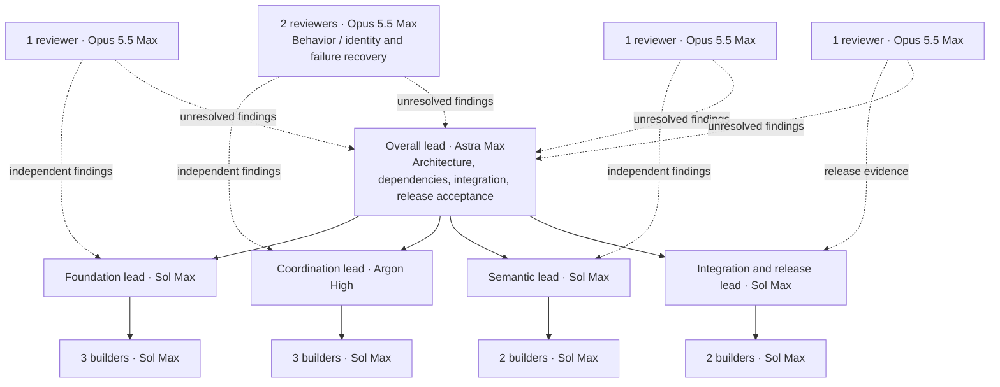
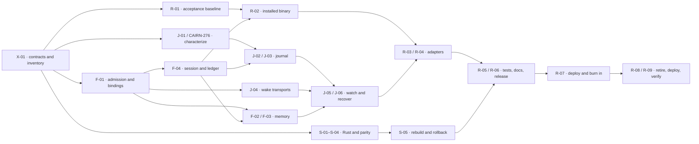

# Hybrid runtime consolidation: organization and implementation

Status: execution authorized and campaign CAIRN-301 started on 2026-11-06. Four domain leads are preparing contracts, work items and independent acceptance reviews under X-01 / CAIRN-302. Dependent implementation remains gated on the [shared contract index](hybrid-runtime-contracts/README.md). This is not implementation, deployment or full-design acceptance. The original plan was prepared against `ff262da8d5caf9bc4a75f76c745b9bff3dcaaba6`; execution began from `d3c255a4bb75438e93527eaa1d83da780fd11eea`.

The [architecture proposal](hybrid-runtime-consolidation.md) defines the destination: Go owns the operational runtime and lifecycle, Rust supplies an isolated semantic worker, and host-required adapters remain thin. This companion defines ownership, delivery order, and prompts for the agents who will execute that work. Existing project instructions and the execution request govern authority.

## Organization

Use four delivery teams and one overall lead: **20 roles comprising one overall lead, four team leads, ten builders, and five reviewers**. These are campaign assignments; they need not all run at once.

| Team | Lead | Builder assignments | Review focus | Milestones |
| --- | --- | --- | --- | --- |
| Foundation | Sol Max | F-B1: bindings, admission and shared primitives; F-B2: recall; F-B3: session/ledger, then capture | Public behavior, persistence and authorization boundaries | HC-03 |
| Coordination | Argon High | J-B1: journal execution/recovery; J-B2: peer and wake transport; J-B3: watcher, transcript and session integration | J-R1: retry/reply behavior; J-R2: identity, locking, cancellation and crashes | HC-04; existing CAIRN-276–278 |
| Semantic | Sol Max | S-B1: inference and tokenization; S-B2: protocol, packaging and Go integration | Numerical/ranking parity, isolation, rebuild and rollback | HC-01, HC-02 |
| Integration and release | Sol Max | R-B1: installers and host adapters; R-B2: independent acceptance, documentation and release evidence | Installed behavior, replacement/refusal paths, documentation and deployment | HC-05, HC-06 |

Team leads create their own Plane items, assign bounded work, resolve local design questions, request independent review, and carry each item through integration. They retain context while builders can be replaced between items. A lead who takes a coding assignment consumes a builder slot and follows the same review rules.

The overall lead owns interfaces shared by teams, the dependency map, the integration queue, and final acceptance. Reviewers report evidence directly to that lead when a dispute remains. No author approves their own change. The coordination reviewers have separate briefs and submit findings independently before seeing each other's conclusions.

Start with six builders: two foundation, one coordination characterization, two semantic, and one release acceptance builder. Increase toward ten when interfaces and dependencies permit. Keep one active writer per file; extra agents do not create more parallelism inside the journal state machine. This session exposes four native agent slots including its root. Greater concurrency requires independently managed host sessions through verified subscription routes; otherwise schedule these roles in waves.

## Launch packet

Each file below is a complete lead prompt. Give it to the specified model with the repository available. The lead then uses the builder and reviewer templates for individual assignments.

| Role | Prompt |
| --- | --- |
| Overall lead | [Astra Max](hybrid-runtime-prompts/overall.md) |
| Foundation lead | [Sol Max](hybrid-runtime-prompts/foundation.md) |
| Coordination lead | [Argon High](hybrid-runtime-prompts/coordination.md) |
| Semantic lead | [Sol Max](hybrid-runtime-prompts/semantic.md) |
| Integration and release lead | [Sol Max](hybrid-runtime-prompts/release.md) |
| Builder assignment | [Sol Max template](hybrid-runtime-prompts/builder.md) |
| Independent review | [Opus 5.5 Max template](hybrid-runtime-prompts/reviewer.md) |

Model labels express the intended routing. At execution start, record the actual model identifier, reasoning setting, harness, and subscription route. Do not substitute another model or use OpenRouter when subscription authentication or quota fails. Stop the affected assignment, report it, and continue independent work where possible. This plan is not a claim that every model is available through this session's native agent tool.

## Corrections and decisions that control execution

1. **Preserve the existing semantic storage model.** At this baseline, `core/schema/056_semantic_passages.sql` keys documents and jobs by record, and passages by record plus ordinal. `semantic/index.go` replaces a record's existing document when writing a new derivation. It does not retain two complete model generations. The selected implementation uses a controlled service switch, a background rebuild with accurately labelled availability, and a tested reverse rebuild for rollback. Retaining multiple generations would be a separate schema change, outside this campaign's default scope.
2. **Only one model generation indexes a shared database queue during a switch.** `semantic/index.go` seeds and claims `cairn.semantic_job` without a collection predicate. Inventory every writer using that database and queue, stop and join the old writers, then start the replacement. A collection-only fence is insufficient. Do not run Python and Rust indexers against the same job queue to simulate a rolling migration. A command change requires a service restart; uninterrupted dense coverage and instant rollback are not promised.
3. **Reuse the journal work already in Plane.** CAIRN-276, CAIRN-277, and CAIRN-278 were all Backlog when inspected on 2026-11-06. Preserve CAIRN-276's characterization gate. The latter two currently prescribe a Python extraction; the coordination lead must revise or explicitly supersede those implementation scopes with the Go owner and recovery work. Preserve their evidence and acceptance requirements. Do not schedule both extractions or mark them complete from planning alone.
4. **Record a current baseline.** The source has 84 SQL files under `core/schema/`, rather than the proposal's `core/migrations/001–079` inventory. Recheck source, installed versions, active clients, schema, model assets, and harness support before launching builders. Do not infer deployment freshness from a version string alone.
5. **Treat performance reductions as targets.** Measure hook latency, worker footprint, test duration, and dependency removal against the same fixtures and machine conditions. No latency threshold in the proposal is an already verified result. Preserve bounded query/document timeouts and existing behavior even if gains are smaller than expected.
6. **Preserve actual launch and command interfaces.** Semantic service flags currently take an absolute executable path without arguments; stage fixed mode/model launchers. The current installer uses `semantic/venv`, so removal follows an installation inventory. Characterize the existing coordination `inbox` command family and watcher `--config-dir` behavior, including commands already issued to live sessions. The proposal's abbreviated CLI sketch is not a complete compatibility contract.
7. **Use source-verified numerical and identity contracts.** The ranker caps 128 chunk occurrences across a request, not per note. Existing Go validation requires 384 finite, nonzero vector components; it does not enforce the proposal's stated norm interval. Preserve and test normalization without inventing an existing rejection rule. Rust derivation identity must cover consumed model/config assets, backend/tokenizer versions, preprocessing and pooling constants, and implementation/source identity so a code change affecting vectors invalidates old derivations. Exclude incidental timestamps and checkout paths.

These corrections refine migration mechanics while retaining the selected Go/Rust architecture. A schema or authority change discovered during implementation gets its own recorded decision and acceptance tests before dependent work continues.

## Ownership and contracts

| Surface | Accountable team | Coordination rule |
| --- | --- | --- |
| Shared state files, peer/process identity, bindings, admission, ledgers, memory hooks | Foundation | Extract existing primitives with a working consumer and regression coverage. Coordination contributes requirements; it does not fork the helpers. |
| Journal state machine, wake adapters, watcher, transcript recovery | Coordination | Keep one journal execution owner. State reads expose named facts without sending commands. |
| Rust worker, semantic protocol fixtures and worker packaging | Semantic | Preserve Go supervision and the existing bounded process boundary. Coordinate service configuration with release. |
| Lifecycle installation, Hermes/OpenCode adapters, acceptance harnesses, documentation, deployed inventory | Integration and release | Own configuration changes and staging. Semantic supplies its binary and model manifest. |
| Shared CLI registration, Makefile targets, final service wiring and dependency disputes | Overall lead | Name one writing team for each change and serialize integration. Ownership does not require the overall lead to write all code. |

Before dependent implementation, record five contracts in the campaign parent: lifecycle command inputs/streams/exit codes; state schemas/locks/persistence order; process identity and wake envelopes; semantic protocol/model identity; and install/pin/drain/rollback behavior. Each contract has an owner, consumers, fixtures, and a revision. The [shared contract index](hybrid-runtime-contracts/README.md) records acceptance and single-writer allocations. Changes notify every consumer before they merge.

Immutable `/2` Python bundles and proposed `/3` binary bindings coexist during migration. A `/2` pin authenticates its Python bundle; it must never be treated as authentication of the Go executable. Route it through the preserved legacy executor or perform an explicit drain and `/3` repin. Keep grant-ledger, native-session, journal, and wake state compatible unless a separately reviewed version transition is necessary. Store-owned identity and observation channels remain authoritative. Frozen `scripts/trial_*` and `scripts/test_trial_*` retain their historical semantics; the experimental SDK custody addon remains outside scope.

## Plane work and completion evidence

The overall lead creates or locates one campaign parent in the work instance's Cairn project. Leads create their child items using the installed `plane` CLI and link them to that parent. HC-01 through HC-06 remain milestones; the IDs below are **plan keys, not created Plane identifiers**. Use deterministic external IDs such as `hybrid-runtime-v1/F-01` to avoid duplicates.

Each lead turns the slices below into independently verifiable work. Split a large item before assignment if its interfaces, review, or failure cases cannot fit one bounded change. All listed items are intended for autonomous execution within the granted project authority; routine agent reviews do not require a new human approval round.

Every item records its outcome, non-goals, size, lead, exact builder/reviewer sessions when known, dependencies, interface revision, acceptance criteria, required tests, documentation work, and rollback implications. Agent/model names are role metadata; do not invent Plane member UUIDs. Use real members for tracker assignment only when a valid mapping exists.

Create native parent and blocking relations where supported, and read them back. The CLI's documented legacy relation tool is the fallback for blocking edges. If unavailable, keep explicit dependency links in the bodies and campaign manifest and label native edges unverified. Leads enforce these dependencies regardless of tracker rendering.

Reviewers examine acceptance criteria before building. Builders provide exact candidate commits and test evidence. Reviewers report concrete defects against those commits; fixes receive a new review of the changed scope. A ticket is Done only after its criteria pass, findings are closed, documentation is current, and the reviewed change is integrated and pushed. Deployment tickets additionally require observed installed and live-client evidence.

## Delivery sequence

Size is relative review/implementation complexity: **S** is one narrow change, **M** is one behavior path, and **L** spans several failure modes or consumers. It is not a time estimate. Builders own complete behaviors with their tests; temporary shared primitives are introduced through compatible consumers so trunk stays usable.

### Campaign setup

| Key | Owner / size | Deliverable and acceptance | Blocked by |
| --- | --- | --- | --- |
| X-01 | Overall / M | Current source/deployment inventory, model routes, five interface contracts, campaign parent, reconciled CAIRN-276–278, and a checked dependency map. Reviewers accept the planned behavioral boundaries. | None |

Read-only inventory, fixture capture, and ticket drafting can proceed together. X-01 closes before contracts are consumed by new implementations.

### Foundation: HC-03

| Key | Size | Deliverable and acceptance | Blocked by |
| --- | --- | --- | --- |
| F-01 | L | A real Go lifecycle admission/binding command path with `/2` compatibility and proposed `/3` validation. Extract shared state-file and peer primitives only with exercised consumers. Reject bad ownership, modes, hashes and stale process identity; preserve refusal output and exit status. | X-01 |
| F-02 | L | Recall through direct `localapi.Client` calls for supported hooks. Differential fixtures preserve required-context refusals, optional degradation, byte budgets, attribution and recall meters. | F-01, F-04 |
| F-03 | L | Capture through Go for supported prompt/compact/stop hooks. Preserve selected-content boundaries, duplicate/request identity behavior, capture meters, stream output and shutdown persistence. | F-01, F-04 |
| F-04 | M | Shared-state and binding-activation operations exercised by the actual memory/coordination frontends through an independently pinned compatibility caller. Concurrent/crashed writers preserve lock semantics, permissions, atomic replacement and durable state. Remaining grant operations land with F-02/F-03; native orchestration and its compiled journal adapter land with J-05. | F-01 |

F-B1 owns shared primitives and admission; F-B2 prepares recall fixtures while F-B3 completes F-04 before capture. The [F-04 consumer decision](hybrid-runtime-contracts/f04-consumer-decision.md) defines the exercised activation subset and independent Python compatibility receipt. Remaining grant operations land with their F-02/F-03 consumers before full memory acceptance. J-05 delivers native orchestration and its journal adapter together; F-04 does not wait for J-05. HC-03 closes after all four items and its supported-harness fixture matrix pass, including complete memory grant behavior. HC-04 accepts native-session transition policy.

### Coordination: HC-04

| Key | Size | Deliverable and acceptance | Blocked by |
| --- | --- | --- | --- |
| J-01 | L | Complete CAIRN-276 characterization with golden traces for explicit retries, ordinary pending-slot watcher replay and the existing committed-completion exact-result recovery exception, refusal finality, lock waits, reply references, legacy journals and the settled-index/finish-reply boundary. Include the full inbox command grammar, issued session commands and multi-account watcher configuration. Record discrepancies without silently fixing them in the oracle. | X-01; existing fixtures can be inspected immediately |
| J-02 | L | Go journal execution owner for explicit inbox commands. Preserve immutable intent, write-before-send, request identity, authenticated retries and exact completion/reply references. Reconcile CAIRN-277's Python-specific scope. | J-01, F-01, F-04 |
| J-03 | L | Ordinary pending-slot recovery, the existing committed-completion exact-result recovery exception and side-effect-free inspection through the journal owner, including lost responses and late replies. Reconcile CAIRN-278. No duplicate transition algorithm remains in production callers. | J-02 |
| J-04 | L | Supported Codex, Claude, OpenCode and Hermes wake adapters using shared peer/process verification. Verify busy/refusal/cancellation behavior, frame bounds and stale-peer rejection with actual process boundaries. | X-01, F-01 |
| J-05 | L | Go presence watcher and native turn/custody integration using the journal owner. Preserve active-attempt gates, cancellation, heartbeat, termination and restart recovery. | J-03, J-04, F-04 |
| J-06 | M | Transcript recovery and recovery command surface integrated with supported harnesses; bounded JSONL handling and other-session isolation pass. | J-05, F-02, F-03 |

J-B1 serializes J-02/J-03. J-B2 can implement wake transport after its contracts land; J-B3 develops watcher/transcript fixtures while journal work proceeds. J-R1 reviews behavior and J-R2 reviews identity and failures independently. Characterization controls implementation order within the full campaign.

### Semantic worker: HC-01 and HC-02

| Key | Size | Deliverable and acceptance | Blocked by |
| --- | --- | --- | --- |
| S-01 | M | Frozen Python protocol/numerical/ranking reference fixtures and a differential harness for all three worker modes. Add a native-executable comparison path because the existing comparator assumes Python scripts. Pin all model/config assets, preprocessing, spans, prefixes and derivation identity; specify exact discrete score/rounding parity separately from vector tolerance. | X-01 |
| S-02 | L | Rust rank and streaming-rank modes through the existing Go supervisors. Match ranking and numeric contracts; malformed frames, deadlines, cancellation and output limits fail correctly. | S-01 |
| S-03 | L | Rust embed mode with metadata handshake, UTF-8 byte spans, passage coverage, normalization and bounded CPU settings. Same-model cosine differences meet the proposal's `1e-6` target and ranking fixtures pass. | S-01 |
| S-04 | M | Reproducible offline worker/model installation for supported host architectures. Prove native-library requirements, provenance, checksums and clean-environment execution. Core Go builds remain usable without Cargo. | S-02, S-03, R-01 supported host/CPU inventory |
| S-05 | L | Disposable-store Python→Rust→Python switch/rebuild and restart recovery tests, default configuration change, and the semantic cutover runbook. Show no concurrent different-model writers and report readiness, incomplete coverage and fallback accurately. | S-04, S-04R, R-01 |

HC-01 closes after S-01–S-04 and worker parity. HC-02 closes after S-05's verified implementation and R-07's installed semantic cutover/re-index evidence. The Rust ORT backend is the initial choice. Packaging failure can reopen that backend decision against the same parity contract; it does not permit silent backend substitution or tolerance relaxation.

The added bounded repair **S-04R / CAIRN-355** qualifies a telemetry-disabled
retained Python launcher/rollback closure, with Semantic implementation and
S-R1 review plus Release rollback review. It depends on X-01, S-01 and R-01,
then gates S-05 and R-06. The frozen oracle and current installed selection are
not silently changed. See the [shared acceptance record](hybrid-runtime-contracts/README.md)
for its isolation, identity and evidence requirements. This is a split repair
within the full campaign, additional to the 25 base plan keys.

### Integration and release: HC-05 and HC-06

| Key | Size | Deliverable and acceptance | Blocked by |
| --- | --- | --- | --- |
| R-01 | M | Independent installed-behavior fixture matrix and baseline measurements. Enumerate each supported harness/operation, unsupported cases, process-boundary tests, model assets, hosts and existing configuration pins. | X-01; discovery can start immediately |
| R-02 | L | Immutable binary staging and `/3` lifecycle installation alongside `/2`, exercising available F-01/F-04 pin/admission/state controls and reverse selection in disposable homes. Preserve unrelated configuration; refuse unsafe live replacement. Complete watcher-unit drain/switch/restart/rollback qualification belongs to R-06 after its lifecycle prerequisites. | F-01, F-04, R-01 |
| R-03 | M | Thin Hermes adapter delegates memory and coordination to the staged binary while preserving actual in-process host contracts, custody and cancellation. | F-02, F-03, J-05, R-02 |
| R-04 | M | OpenCode adapter and Claude/Codex/Agy hook wiring use the staged binary for their supported operations. Fresh and existing sessions work after targeted refresh; unsupported harness operations remain explicit. | J-06, R-02 |
| R-05 | L | Selective migration of slow checks to Go, with independent process/crash/install coverage retained. Profile before and after; demonstrate equivalent assertions and fixtures before removing old checks. | F-02, F-03, J-06, S-05, R-01 |
| R-06 | M | Full documentation audit and release candidate. Qualify drain/switch/restart/rollback for each complete watcher, all config-dir bindings and shared-state/runtime users after lifecycle prerequisites. Update architecture/status, CLI and lifecycle references, all affected harness guides, installation, semantic operation, testing, rollout and rollback. Local checks and independent release review pass. | R-03, R-04, R-05, S-05, S-04R |
| R-07 | L | Deploy the reviewed release to every currently managed Cairn host/client. Re-inventory known Proximal, Archon and Talos installations; drain and switch each supported harness and semantic service; verify actual binaries, configuration, schemas, live connections and re-index completion. | R-06 |
| R-08 | M | Complete burn-in, then retire live Python lifecycle installs and unused semantic/websocket dependencies. Preserve required Hermes Python, frozen trials and the documented rollback artifacts. No active configuration or process references a retired runtime. | R-07, burn-in exit criteria |
| R-09 | M | Verify the final removal commit, deploy it everywhere, and reconcile every host/client against that final commit. Publish final operational evidence and close the campaign after independent acceptance. | R-08 |

HC-05 closes after R-02–R-06 and the complete installed harness matrix. HC-06 closes after R-08/R-09. Documentation moves with each feature; R-06 is the final audit of the combined result. The release team delegates host verification sequentially where service state is shared and does not compete with other teams for production control.

The tables are the authoritative dependency list; this diagram groups related items for readability. There are 25 plan keys, including setup. Leads can split them while preserving the milestone boundaries and blocking edges.

## Verification and release gates

**Before review:** each builder runs focused behavioral tests, records the exact command, commit, environment and result, and updates affected documentation. For state/store changes, run `make check` and `make test-integration`; use only disposable PostgreSQL. Local validation remains mandatory; no GitHub Actions workflow is added. Run `make test-lifecycle` when backup, restore or service lifecycle changes require it.

Semantic acceptance must execute the prepared Rust worker and reference Python worker, rather than rely on default suites that skip actual-model tests without their configured executables/assets. Add dedicated Cargo build/test targets and make the acceptance runner fail when required model tests are skipped. Re-index completion compares eligible current records, versions and body hashes against the selected derivation; an empty job queue or a ready query alone does not establish full coverage.

**At integration:** review the exact candidate commit and its contracts. Keep the existing Python implementation as the reference until independent fixtures prove replacement behavior. Any normalization of timestamps, generated IDs, or temporary paths must be declared in the fixture; never normalize away refusals, request identity, ordering, spans or persisted state. Run process-level checks for termination, pipe behavior, installed pins, locking and restart, even if other tests use in-process servers.

**Before deployment:** the integration lead produces one release manifest with source commit, Go/Rust binary hashes, model assets, schema expectations, host/client inventory, required checks and rollback material. Verify fresh installation without a checkout and without the removed runtime dependencies. Confirm backup and restore evidence for any operational data transition. Production services are never test fixtures.

**During deployment:** one owner controls each host/service. Apply configuration through the documented installer/service procedure, then verify the running executable and active client connection. A new binary on disk is insufficient: account and repository configuration pins, MCP facades, hooks, watchers and long-lived harnesses must be refreshed through their supported mechanisms. Do not replace conversations or adopt another session's inbox to bypass a failed refresh.

**Burn-in exit:** plan for at least 24 continuous hours after the last relevant runtime correction, one completed semantic rebuild, and observed recall/capture plus supported request/reply/recovery cycles for every installed harness. Include idle/busy, restart, cancellation where supported, and rollback rehearsal evidence. Track unexplained refusals, pending jobs, stuck inbox work and worker failures. Reset the affected lane's observation window after a fix. The overall lead may extend the window when representative activity is missing; elapsed time alone cannot satisfy acceptance.

**Final acceptance:** verify the exact removal commit after R-08, repeat checks affected by removal, deploy that commit everywhere, and confirm no live dependency on retired modules. All blocking findings and Plane items must be closed with evidence; all worktrees and branches created by the campaign must be integrated and removed; `main` must be pushed and each checkout clean. Report source implementation, tested behavior, installed deployment, and measured benefits separately.

## Working protocol

Leads report a compact state update after each handoff or material change: completed commits, active Plane items, blocked dependencies, findings, and next available work. Use Cairn's existing scoped coordination and memory interfaces where available. Preserve the provisioned identity/profile and exact source context. Do not re-register sessions, replay held work, or expose credentials. Plane holds the work state; Cairn carries selected decisions and handoffs rather than copies of raw sessions.

Builders use `git-wt create` for isolation and the repository's trunk-integration procedure. Review happens before landing; the assigned builder remains responsible for integration and cleanup. The overall lead serializes landing of overlapping changes. A concurrent trunk update requires reconciliation and appropriate re-verification of the changed result.

Failure to launch a specified model blocks that role, not unrelated teams. A behavioral discrepancy blocks the affected migration until it is understood and characterized. Failed parity, identity checks, unsafe replacement, or missing rollback evidence blocks the affected cutover. Leads can repair scoped defects autonomously; changes to authority, persisted schemas, or the selected architecture require an explicit decision recorded by the overall lead within the owner's authorization.
