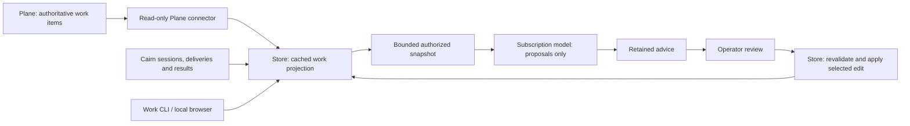

# Work coordination design

Status: proposed implementation contract, 2026-11-05. None of the interfaces
marked **proposed** below is implemented by this document. Baseline:
`48ddbdcfb999e770f5147be3b3b6b71ccfd7fb8e`. The companion
[implementation plan](work-coordination-implementation.md) defines delivery order,
acceptance checks and rollback.

The requested outcome is five usable features: a shared work view, durable
waits, task–artifact links, next-user-turn notices, and model-assisted
coordination. Ship complete, narrow workflows with ordinary failure handling.
Their release does not depend on an experiment proving usefulness first. If a
feature proves unhelpful, disable and remove it through the retirement contracts
below. Correctness checks remain release requirements.

## User workflows

1. Open a project work view and see its Plane items, explicitly associated agent
   executions, outstanding requests, blockers and selected results. Inspect
   freshness without waking a worker or reading its private conversation.
2. Register a wait on a response group or a direct request. Finish the current
   turn. Receive one durable terminal notification when the condition is met or
   its deadline is reached; inspect or cancel the wait at any time.
3. Link a commit, report or other exact artifact revision to one or more work
   items. Navigate in both directions and see who asserted each relationship.
4. Send an optional update for a recipient's next user-initiated turn. It causes
   no wake. Inspect whether it is queued, admitted, expired or explicitly flushed
   into normal delivery; each admitted notice still receives its own outcome.
5. Ask for coordination suggestions, inspect their cited observations and exact
   proposed changes, and apply selected suggestions. Apply changes only Cairn's
   selected progress, blocker annotations or explicit artifact links. It cannot
   mark a Plane item done, complete a delivery or interrupt an agent.

The work view is the common navigation surface. CLI access is equally complete:
no operation requires a browser. Every change that advice can propose is also
available as a manual command.

## Ownership and vocabulary

These are proposed domain terms. Add them to the existing glossary when their
implementations land; do not redefine the existing instrumented Task or memory
Record as a Kanban card.

| Term | Meaning and authority |
| --- | --- |
| Work project | Explicit association between a Cairn collection and one Plane instance, workspace and project UUID. Collection identity alone never selects a project. |
| Work item | A stable reference to an external Plane item. Plane owns its title, workflow state and assignees. Cairn caches a projection of those fields. |
| Work association | An attributed link from a work item to an exact Cairn session/execution, request, response group, run or selected result. Association is reported context, not assignment authority. |
| Progress annotation | Selected operational prose with author, time and optional source references. It does not replace another agent's task summary or certify progress. |
| Blocker annotation | An explicitly open or resolved coordination concern attached to a work item. It does not change Plane's workflow state. |
| Work artifact | A named external deliverable with immutable revisions and a canonical locator. It is distinct from a managed evidence object or a memory record. |
| Artifact link | An attributed input, output or evidence association between a work item and an exact work-artifact revision. The word evidence here labels the association; it does not qualify a memory claim. |
| Wait | A durable subscription to one precisely identified coordination condition, with a deadline and a terminal notification. It does not park a process or hold a delivery lease. |
| Next-turn notice | An optional notice retained until an admitted user-initiated turn, explicit publisher flush or expiry. It is separate from ambient memory retrieval. |
| Work advice | Immutable model-generated proposals against an exact input snapshot, reviewed and applied individually through existing work-edit rules. It conveys no authority. |

Plane owns work-item state. PostgreSQL owns associations, annotations, waits,
notice admission and advice state. The local API establishes identity and
privacy. Native integrations establish supported turn observations. Models
suggest changes; deterministic Store operations validate and commit them.

## Existing contracts retained

The [event fabric](../agent-event-fabric.md),
[response groups](../response-groups.md), [native inbox](../native-inbox.md),
[request controls](../request-controls.md) and
[restore admission](../restore-admission.md) remain authoritative for current
behavior. Implement extensions in their existing Store transactions and
operation catalog rather than a second queue or task-state engine.

- PostgreSQL remains the operational store. No Markdown/FUSE authority or new
  distributed replica is introduced.
- Store-owned producer/channel identity, sensitivity and authenticated
  destination remain unchanged. A project label, UUID or model assertion is
  never authentication.
- Delivery, source availability, reported completion and task acceptance stay
  distinct. Waiting for a response is not waiting for verified success.
- Reusable memory remains selected capture. Work projections, annotations,
  advice and next-turn queues are operational data outside ordinary note search.
- Model and Plane calls run outside Store transactions. Retain intent before an
  external invocation; uncertain outcomes are explicit. No automatic model
  fallback on subscription authentication or quota failure.
- There is no raw transcript, reasoning-trace or automatic repository scan in
  this design. External artifact URLs are locators, never fetch instructions.

## Shared mutation and read rules

New Store mutations use the existing authenticated caller/operation/request UUID
idempotency contract and immutable intent digest. Edits carry an expected
revision. Retrying the same operation returns its retained result; changing
intent under the same UUID refuses. Cached responses describe the mutation at
that time; list/show reads describe current state.

Every new row has a collection and store-stamped author/observation channel.
Project references are server-created bindings, not payload-selected access.
Operational work metadata is local-only in the first release. The work browser,
Plane cache, links and advice are operator surfaces; do not expose these through
ordinary hosted memory tools. Session-owned waits and next-turn notice handling
use the existing authenticated agent channel and destination checks.

New paged reads default to 50 entries, cap at 100 and use stable ID/revision
cursors bound to collection, filter and restore generation. Lists are current
views, not promises of a complete change stream. The browser polls a bounded
snapshot every 10 seconds; no SSE event log is needed for the first release.
Each source reports its own observation time. Do not describe a join across
Plane and Cairn as an atomic snapshot.

Proposed feature declarations are closed, versioned capabilities: `work-view/1`,
`work-artifacts/1`, `coordination-waits/1`, `next-turn-notices/1` and
`work-advice/1`. Missing or malformed support refuses new intent before a write;
never silently downgrade a next-turn notice into a wakeable ordinary notice.
Add typed work-operation metadata and refusal codes to the shared contract, but
do not mount operator work operations in the ordinary agent API. Its existing
local-destination profiles do not establish `Channel.Operator`. The OS operator
CLI and its dedicated loopback work server open Store with the existing operator
channel. Browser authentication grants access only to that bounded server's work
operations. Session wait/notice operations enter `localapi.OperationSpec` with
their existing authenticated session checks; local destination alone never grants
operator authority.

## 1. Shared work view

### Useful first release

The operator selects an explicitly configured project, opens the board, filters
by Plane state or local blocker, and inspects an item. The item page shows:

- Plane title, state, assignees and source link, with last successful refresh and
  current refresh error/staleness;
- explicitly linked sessions with execution UUID, presence expiry and selected
  task summary; an old execution is historical, never silently replaced;
- linked requests, response groups and result references with their actual
  delivery/collection states and current payload availability;
- selected progress annotations and open/resolved blocker annotations;
- exact artifact links, waits, optional notice backlog and advice as later slices
  land. Omit unavailable feature controls rather than rendering fake data.

Provide list/detail JSON and a readable CLI table using the same query contract.
Empty projects, no associations, stale Plane data, unavailable result bodies and
partial pagination are normal visible states. Do not infer an idle worker is
stalled or that a busy worker is making progress.

### Project binding and Plane acquisition

Proposed `work project add` takes a local slug, collection, configured Plane
instance name, workspace and project UUID. Resolve and show the immutable tuple
before committing the binding. Pin the normalized Plane origin, workspace UUID,
project UUID and connector identity/configuration revision; the configured
instance name is only a selector. Revalidate its effective configuration before
every refresh. Repointing that profile refuses refresh until a new explicit
binding is created. Changing a UUID creates a different binding;
renaming a display slug does not retarget history. Do not derive the project
from a working-directory path or from the shared collection name.

The connector invokes the installed `plane` CLI using an argument vector and an
explicit instance/project. It calls only project, state and issue read commands;
never create/update/comment. Keep credentials in the existing Plane profile.
Normalize only item UUID/identifier, title, state ID/name/group, assignee IDs and
display names, updated time and canonical source URL. Do not cache descriptions,
comments, attachments, email addresses or credentials.

An explicit refresh and an optional operator-started sync worker use the same
bounded connector. Refresh at most once per project per minute; allow one
in-flight refresh per binding, a 30-second timeout and a 16 MiB output cap. Drain
all result pages for a snapshot up to 10,000 items. Larger projects report
`PROJECT_TOO_LARGE` and retain the prior snapshot as stale; an incomplete scan
cannot become a complete project view.

Stage a complete normalized refresh, then swap the project's cache generation
in one transaction. Overlapping refreshes use the binding revision and refresh
sequence to reject an older response. Cache import serializes with metadata purge
and applies current exclusions inside that transaction. Purge increments the
binding's metadata/exclusion revision; a staged refresh or advice completion/apply
with an older revision must revalidate and cannot restore removed fields.
A failed or partial refresh retains the
last good snapshot and records an error. A successful complete scan may mark an
item absent; it never deletes associations or interprets disappearance as Done.
Data older than two minutes is visibly stale. This threshold is a display policy,
not an availability or correctness guarantee.

### Work associations and annotations

Create a local work-item reference on first explicit import or association,
unique on binding plus Plane item UUID. Retain the external identity even when
its projection disappears. Explicit association targets are typed: session
(agent UUID plus execution UUID), event, response group, run receipt, or exact
result record/version. Validate visibility and collection at creation and each
read. No heuristic joins by task-summary text, title or workspace path.

Association records have UUID, revision, target, author, time, active/removed
state and an optional selected rationale. Re-adding the same active exact
association is idempotent; removal retains who removed it. A session resume does
not transfer an old execution association. The operator can explicitly link the
new execution while preserving the old one for context. When the current session
row names a different execution, show only retained association information for
the old link; never display the new execution's task summary as historical data.

Progress annotations are capped at 2 KiB UTF-8; blockers at 2 KiB plus optional
visible source references. Authors and edits are retained in bounded revision
history; editing requires expected revision. Operator annotations are labelled
operator-reported. Agents do not gain permission to modify Plane or another
session's metadata. Resolving a blocker changes that annotation only.

### Browser and module shape

Add a Go `workview` presentation module using embedded HTML/CSS/ES modules. Its
query module composes Store data; the Plane connector is the only external
adapter. Do not let handlers issue ad hoc SQL or let the connector own state
transitions. UI controls perform the same explicit association/annotation
commands as CLI callers; Plane task fields remain read-only with an Open in
Plane link.

Proposed `work serve` binds loopback only. The OS operator starts it with the
existing operator Store channel; a local-destination agent token cannot start or
authenticate to this surface. Issue a short-lived, one-use launch credential on
the operator's terminal, paste it into the browser's login form, and exchange it
for an HttpOnly,
SameSite=Strict browser session. Use an exact Host/Origin allowlist, no CORS,
CSRF protection for mutations, and no token in URLs, referrers or logs. SSH port
forwarding is the documented remote viewing route; arbitrary network binding
is outside this release. Do not serve or execute linked HTML artifacts in this
privileged origin; open validated HTTPS locators in a separate tab with
`noopener,noreferrer`.

## 3. Work-artifact relationships

An artifact is an external identity; its revisions are immutable locators.
Initial kinds are Git commit, report, CI run, and exact Cairn result. There is no
registry-wide scraper, graph database or automatic semantic extraction.

- Git: configured repository identity plus full commit object ID. Branch names
  are display hints, never revision identity. Registration may verify the object
  through the configured local checkout without modifying it.
- Report: operator-supplied HTTPS locator plus a revision label and optional
  content digest. A URL without a verified digest is labelled an unverified
  locator; it is still useful to navigate. No server-side fetch.
- CI run: provider/repository/run ID and attempt or external revision. It is a
  locator and selected status observation, not imported proof of passing tests.
- Cairn result: exact record ID/version, with current visibility and forgetting
  checks. Removing payload availability does not erase the historical link.

Use PostgreSQL `work_artifact`, immutable `work_artifact_revision`, and versioned
`work_artifact_link` rows. An artifact revision may link to several work items;
a work item may link to several revisions. Link roles are `input`, `output`,
`evidence`. Uniqueness covers work item, exact revision and role. Preserve link
provenance, asserted time and removed state. A new artifact revision never
rewrites old links. Do not overload `RecordRelation`: its existing lifecycle and
scope rules have another purpose.

The item page supports registering/linking an artifact, removing a link and
opening its locator. An artifact page and CLI reverse lookup show all associated
items, their current cached Plane states, linked executions and open blockers.
These reads do not wake anyone or close tasks. Invalid locators refuse;
unsupported schemes, embedded credentials, script URLs and local file-serving
paths are never clickable browser targets.

A source privacy change masks unavailable Cairn references on every read.
Local projection access does not broaden a record's actual read authorization.
Artifact and link purge is explicit operator maintenance; active references from
advice or annotations must be removed or masked in the same transaction.
Generic metadata deletion must not bypass memory-record forgetting rules.

## 2. Durable coordination waits

### Predicates, owner and state

A registered session can wait on coordination work it published. Support two
closed predicates in version 1:

| Predicate | Satisfied by |
| --- | --- |
| `response_group_closed` | Caller-owned group reaches collected, partial or incomplete for a normal closure, not restore fencing. |
| `request_response` | First qualifying explicit reply to the caller's direct-agent request. Topic/pool work uses a response group. |

A direct reply must come from the original delivery's consumer, name the exact
request as causation, target the original publisher and match correlation,
including both correlations absent. Choose the earliest qualifying retained
event position. A handled request without a response does not satisfy the wait.
A failure report can satisfy it; the notification never claims task success.

Persist `agent_wait`: UUID, collection, owner principal, owner agent UUID,
creation execution UUID, authenticated registration destination and sensitivity
ceiling, profile/binding identity for current revalidation, predicate version/kind,
dependency event UUID,
deadline, generation, timestamps, state and selected response reference.
States are `waiting`, `satisfied`, `timed_out`, `cancelled`, `restore_fenced`.
Reserve one notification event UUID and source-record UUID at creation. A unique
outbox row records `pending`, `published`, `restricted` or `restore_fenced`.
No callback program, payload body or model-generated predicate is stored.

The conversation owns the wait. A legitimate resumed execution can inspect or
cancel it through the existing session association; a stale execution cannot.
A notification is addressed to that conversation and can wait while it is
offline. No replacement session is started. Bound admission to 100 open waits
per session and 1,000 per collection. Require an explicit future, offset-qualified
deadline at most 30 days away. These are initial product limits, not benchmark
claims. One open wait per owner/predicate/dependency prevents duplicate joins;
a conflicting deadline requires cancellation and new intent.

### No missed completion or duplicate continuation notice

Use generation lock, collection insertion lock, then dependency/wait rows in
stable UUID order. The same order governs registration, relevant response
publication, group closure, cancellation and timeout.

Registration inserts the wait and checks retained dependency state in one
transaction. A response or closure before registration can satisfy it
immediately. Response publication and group closure resolve matching waits in
their existing transaction, inserting the unique notification outbox row with
the terminal transition. Scheduler reconciliation also examines waiting rows;
correctness does not depend on every process having seen an in-memory callback.

Use persisted database event timestamps obtained under the coordination lock to
test a reply against the wait deadline, not client clocks or an assumed wall-clock
commit time. Registration, response publication and timeout use this same clock
and serialization boundary. For a
group's deadline closure use its deadline as the effective time; for all-replied
closure use its retained closure time. A timely response remains timely after a
scheduler outage. Equality with the wait deadline belongs to timeout.
Cancellation that obtains the lock first wins and creates no notification.
Cancelling a terminal wait refuses with `VERSION_CONFLICT`. A pure read can show
`overdue: true` but never claims that it persisted timeout.

The operator scheduler drains the outbox with an internal Store operation. One
transaction creates a fixed-format, task-scoped selected notice source,
publishes the reserved notice event, and marks the outbox published. The producer
is the scheduler's established operator channel, not an impersonation of the
wait owner or responder. Retries cannot allocate another event. The text says
that wait X resolved or timed out and directs the recipient to inspect it. It
copies no result body and contains no executable callback. Source scope is a
dedicated wait-notification task, outside ordinary reusable memory searches.

Recheck dependency availability using the retained registration destination and
ceiling intersected with the owner's currently valid binding permissions. The
scheduler's local view or a later wider profile cannot widen that constraint.
If the binding is revoked or the dependency is no longer eligible, keep the
outbox `restricted`, expose that state to its authorized owner and do not publish
formerly available information. Exact results are read separately through their
normal interfaces. Notification delivery/acknowledgment remains independent of
wait resolution. Scheduler outage is visible as a resolved wait with a pending
notification, not lost completion.

### Complete interfaces

Proposed CLI family: `wait create`, `wait get`, `wait list`, `wait cancel`.
Creation takes request UUID, predicate, dependency event UUID and deadline, plus
existing connection/session flags. It is nonblocking and returns the wait and
current notification state. List/get never renew presence or consume events.

Add authenticated agent operations `wait-create`, `wait-get`, `wait-list`,
`wait-cancel` with the same fields and ownership checks. Agents can use the CLI
through existing tool access; this release does not require broadening the
ordinary memory MCP tool catalog. The work view shows waits for explicitly
associated events, with owner, dependency, deadline, terminal reason and
notification delivery state. Local operator inspection does not confer ownership
of a group's replies on another agent.

## 4. Notices for the next user turn

### Publication that cannot cause a wake

A new versioned notice delivery policy supports `next_organic_turn`. It applies
only to `notice` events addressed directly to a registered existing-session
recipient whose installed binding declares support. No topics, pools, requests,
responses or preemptive interruptions are included. Keep the existing routine/
urgent `NoticeWakePolicy` version 1 unchanged.

Publish the ordinary exact-source event and an `agent_organic_notice` row in one
transaction, but create **no ordinary delivery row yet**. The queue row contains
event/recipient/publisher identities, reserved delivery UUID, creation/expiry,
restore generation, state and eventual admission identity. States are `queued`,
`admitted`, `flushed`, `expired`, `unavailable`, `restore_fenced`.

This separate admission queue prevents generic inbox readers and old wake
watchers from mistaking a quiet update for ready work. A large availability
timestamp would not provide that protection. Event status must show this queued
recipient explicitly; an event with zero ordinary deliveries must not appear
successfully handled or lost.

Require expiry between one minute and seven days. Cap queued notices at 100 per
recipient and 1,000 per collection. Overflow refuses the new publication
atomically; never silently discard an older update or merge source identities.
Queue/status inspection reports count, oldest age, expiry and support state.

Proposed publication options are `--notice-delivery next-organic-turn` and
`--notice-expires-at`, expressed by a separate versioned request field. New
`notice-pending` inspection includes queued and terminal admission states.
Extend publisher-owned `notice-flush` to materialize the reserved ordinary
delivery exactly once and mark `flushed`; normal wake behavior then applies.
Expiry before flush refuses resurrection. A new notice requires new intent.

### Prove an independently initiated turn

A user-initiated turn is a fresh owner input with stable native identity and a
supported origin observation. It excludes queue/channel wake messages, background
notifications, tool continuations, bootstrap/compaction, repeated callbacks and
owner input joined into a turn already owned by a wake. Absence of a recorded
wake is not proof of user origin.

The installed host binding advertises this capability only after its adapter
propagates typed origin from the native input seam. Implement Codex, Claude,
OpenCode and Hermes origin handling as part of this feature. Agy remains
explicitly unsupported until it has an equivalent stable owner-turn contract;
publication refuses `UNSUPPORTED_DELIVERY`, rather than accepting a notice that
cannot be consumed. This is a supported-product matrix, not an experiment gate.

Add host-only `session-organic-notice-claim` through the existing base-profile
and session association. Ordinary session-selected API calls cannot supply an
`organic=true` flag to gain admission. The host journals a request UUID before
calling and supplies native owner-turn ID, execution and versioned origin
observation. This is trusted-host provenance, not protection against a hostile
process holding the same profile credential.

### Admit and handle a bounded burst

Under generation, collection, session and queue-row locks, validate the current
execution, installed capability, exact turn origin and source eligibility.
Normal admitted inbox work takes precedence. A live hold or ready request/urgent
notice defers quiet admission. Freeze the turn's decision, including an empty
result, so repeated hooks cannot pick up later arrivals.

Persist a Store-owned organic-turn admission row unique on collection, session,
execution and native owner-turn ID. It retains the origin-contract version,
null/root decision, cutoff, admitted count and limit. A conflicting origin version
cannot reopen the same turn. Tag every materialized attempt with its admission
kind and root. Advance requires that exact root and rejects ordinary or foreign
attempts. A new request UUID cannot reopen a null or exhausted turn.

Choose the oldest eligible queue entry existing at the root admission cutoff.
Atomically create its reserved ordinary delivery, lease it, open a nonexclusive
native attempt, and mark the queue row admitted. Return the current exact-source
and acknowledgment commands. An ambient notice cannot authorize cancelling the
user's shared turn. If the source became unavailable, record `unavailable` with
a bounded reason and continue only within the bounded admission scan.

Allow up to three quiet notices per admitted user turn, matching the existing
native notice burst size. Materialize **one at a time**, only after the previous
notice was explicitly settled. An organic-aware advance operation retains root,
cutoff, index and limit; it rechecks priority work, current session and remaining
context allowance before each item. Never precreate wakeable deliveries for the
rest of the burst. Later arrivals and unadmitted remainder stay queued. The
context reports the remaining count/earliest expiry without copying all bodies.

The existing native journal, hold, exact-source read and per-item
handled/ignored/failed outcomes apply after materialization. Rendering an update
is not acknowledgment. A crash after materialization but before rendering keeps
its hold for the existing recovery process; do not put it back into the quiet
queue or start another turn. Once admitted, queue expiry no longer overrides
lease/hold recovery. Expiry while queued creates no delivery or wake.

A quiet entry follows the same conversation into a legitimate later execution;
an admitted attempt remains bound to its exact execution. A stopped session
cannot admit. The publisher can inspect, explicitly flush or let queued entries
expire. No automatic escalation changes their delivery mode.

## 5. Model-assisted coordination

### Useful actions and review

The first release supports three action types against one selected work item:

| Action | Effect after explicit acceptance |
| --- | --- |
| `annotate_progress` | Add an operator-attributed selected summary, with model-assistance provenance and cited snapshot sources. |
| `annotate_blocker` | Create a blocker or resolve the accepting actor's exact existing blocker revision. Resolution withdraws that annotation; it does not assert that work resumed. |
| `link_artifact` | Add an input/output/evidence link to an already registered exact artifact revision present in the input manifest. |

Do not generate new artifact locators, resource creation, worker reassignment,
Plane transitions, grant changes, inbox publication or interruption. Do not
replace a worker's report with the model's interpretation. No confidence number
permits an action. Unsupported actions or unknown IDs reject the proposal batch
rather than silently accepting a different subset of the model's response.

Use a separate WorkAdvice module. The existing lesson proposals in
`core/proposals.go` have a failure-receipt/assessment contract and should not
become a generic proposal framework.

Proposed CLI commands are `work advice generate`, `list`, `show`, `apply`,
`reject`, and `undo`. Generate takes a work item, an operator-selected registered
model profile, request UUID and explicit additional source/artifact IDs. Show
presents the input manifest, source times, exact before/after changes, rationale,
route and currentness. Apply takes selected action UUIDs, expected review version
and request UUID. Selection and effects commit atomically: there is no
accepted-but-unapplied gap. Unselected actions remain pending. Reject records a
choice without changing work metadata.

The work view adds a Suggestions panel with the same source inspection, Generate,
Accept selected, Reject and Undo controls. These are protected operator commands
through the authenticated work session, not model tools. Operator review is a
normal product action; it is not a planning interview or prerequisite for agents
to implement this design.

Undo creates compensating annotation withdrawal/link removal, or reopens a blocker
resolved by that application with its prior open annotation state. Compensation
creates a new revision and preserves history. It is allowed only while affected
rows still equal the application's recorded output revisions. Intervening edits
produce `UNDO_CONFLICT`; do not overwrite them. One selected application's undo
is atomic. It does not delete history or revert Plane.

### Snapshot, currentness and privacy

The snapshot builder selects work projection fields, annotations, exact linked
execution/event/run facts and selected artifact metadata. Result-note text is
included only when explicitly selected and eligible for the hosted destination.
Use source IDs, exact versions/digests and observation times throughout. No
private transcript, reasoning trace, repository walk, arbitrary URL fetch or
artifact-body ingestion is included.

Work metadata is local by default. An operator can configure a project advice
policy naming exactly which normalized fields may enter the hosted subscription
route. That policy is not permission to serve the whole work view to hosted
agents. A selected source that is not eligible refuses generation before model
launch. Do not silently remove requested sources and pretend the model reviewed
them. Existing note/evidence privacy checks remain mandatory even under a project
policy. The CLI and UI show the selected field policy and manifest.

Initial limits: 32 KiB canonical input, 32 sources, 20 candidate artifact
revisions, 12 actions and 16 KiB normalized output. Annotation text is at most
2 KiB, rationale at most 1 KiB per action. Oversize input refuses rather than
truncating evidence. Numbers are product bounds, not measured optimal settings.

Persist immutable input/manifest, schema/template version, profile revision,
content digest and parsed output. Proposals expire one hour after snapshot
capture. Input payload expires after 24 hours; unapplied proposal text after
seven days; minimal non-payload job/action metadata after 30 days. Applied
annotations follow work-metadata retention. Bounded cleanup runs even when
new generation is disabled. Explicit source forgetting takes precedence over
these maximum lifetimes and purges known copied text and retry responses.

At generation completion and apply, recheck restore generation, binding revision,
source eligibility, semantic source versions and target revisions. Heartbeats
alone do not invalidate a proposal; execution replacement or changed selected
progress does. If advice depends on presence, its freshness is an explicit
precondition. Require Plane fields used by advice to have a successful refresh
within two minutes. Refresh happens outside the transaction. A changed relevant
projection invalidates the proposal; do not silently rebase it. This proves the
local snapshot, not unchanged remote Plane state after the observation.

Apply locks advice and targets in deterministic order and calls private
transaction-scoped WorkProjection validators. All selected effects and the
application receipt commit together under normal request idempotency. The
requester, model provenance and applying actor are separate fields. A model
child receives no Cairn profile credential or mutation tool.

### One complete subscription adapter

Ship a `claude-subscription` adapter using an explicitly registered installed CLI,
existing configuration home and fixed model. Do not depend on the trial execution
harness or its alternate-provider routes. A later adapter must meet the same
contract before being advertised; one complete working adapter is enough for
this release.

Registration and each invocation verify executable identity/version, required
flags and the effective subscription route. Use the CLI's auth-status interface
under the same profile/environment as execution. Require a recognized logged-in
first-party subscription; reject an unknown shape, API-key route, alternate
provider override or policy configuration whose behavior cannot be established.
Do not copy, print or provision credentials.

Use print mode with JSON schema output, safe mode, empty tools and MCP configuration,
no slash commands, browser integration, session persistence or interactive
permission prompts, and no project setting sources. The installed CLI checked
for this design supports those controls. Implement the driver against verified
help/version fixtures and check that disabling project settings does not discard
the selected subscription identity. Do not use API-key-only bare mode or fallback
model flags. Child environment removes API-key and provider-routing overrides;
model/profile choice never comes from source text. Launch from an empty private
working directory with input on stdin and arguments as an array.

Run one invocation per requested generation. Default deadline is 90 seconds,
configurable from 10 to 180; at most two jobs per host, one per work item and ten
new jobs per profile per hour. Duplicate pending input/profile/template identities
return the existing job. Explicit regenerate uses new intent. No automatic
repair prompts or retry generation. Authentication/quota failure stops the job
and is reported; there is no subscription-to-API or provider/account fallback.
Input/output/deadline limits do not promise a dollar or token ceiling unavailable
from the subscription interface.

Persist launch intent before the child starts. Bound output while reading, kill
and verify the owned process group on timeout/overflow/cancellation, and remove
temporary input/output. A host crash leaves the job interrupted/uncertain; startup
first reconciles its exact owned process. It never launches a duplicate generation
because the response was lost. A late exact output may be retained once by job ID
and digest if still eligible; stale output cannot be applied. Retain selected
normalized output and safe error categories, not raw provider output.

## Proposed operation inventory

All names in this table are future interfaces, not commands to run against the
baseline binary. Typed request/response definitions enter the existing operation
catalog and generated contract in the implementing slice. All mutation requests
carry request UUID; revisions are required when editing existing state.

| CLI family | Store responsibility and principal |
| --- | --- |
| `work project add/show/disable`, `work refresh` | Operator binds exact external project, records read-only refresh outcome and atomically imports cache generation. |
| `work list/show`, `work serve` | Operator reads bounded local projection; display never mutates Plane, presence, leases or delivery. |
| `work associate/unassociate` | Operator validates exact visible target and changes a versioned association. |
| `work progress add/edit`, `work blocker add/resolve` | Operator creates separately attributed selected annotations; never overwrites session metadata. |
| `work artifact register/show/link/unlink/impact` | Operator maintains exact revisions and explicit graph; no network fetching or external state changes. |
| `work metadata purge/exclude` | Operator removes selected cached/copied metadata and records restore-safe refresh exclusions. |
| `wait create/get/list/cancel` | Existing session channel owns the wait; dependency ownership and original recipient are checked. |
| `notice-pending`, extended `notice-flush` | Recipient/publisher sees its queue; original publisher may materialize one event's ordinary delivery. |
| Native organic claim/advance | Existing host profile and current session/turn identity perform admission; ordinary agent clients cannot assert origin. |
| `work advice generate/list/show/apply/reject/undo` | Operator selects inputs and profile, reviews, applies or compensates exact local effects. |
| `work features status/disable/retire` | Operator stops new admission, inspects accepted durable work and performs explicit retirement. |

Errors reuse existing `INVALID_REQUEST`, `AUTHORITY_DENIED`,
`IDEMPOTENCY_CONFLICT`, `VERSION_CONFLICT`, `STALE_SESSION`, `RESTORE_PAUSED` and
`SCHEMA_MISMATCH` when their current meaning fits. Proposed distinct outcomes
include `SOURCE_INELIGIBLE`, `UNSUPPORTED_DELIVERY`, `QUEUE_FULL`,
`PROJECT_TOO_LARGE`, `STALE_PROPOSAL`, `PROPOSAL_EXPIRED`, `UNDO_CONFLICT`,
`SUBSCRIPTION_REQUIRED`, `QUOTA_EXHAUSTED`, `MODEL_TIMEOUT` and `INVALID_PROPOSAL`.
Names must be cataloged with tests rather than mapped to a generic success or
private provider error text. All show/status commands distinguish current state
from retained mutation-response state.

## Privacy, deletion and restore across the five features

The work browser must consult Store admission; it cannot serve a disconnected
old cache during restore pause. A Plane authentication/authorization rejection
hides cached external card fields until access is re-established. Network failure
can display the last authorized snapshot as stale. Partial pagination never
certifies absence.

Provide explicit metadata purge for cached titles, annotations, artifact labels/
locators and link reasons. Purge traverses known advice snapshots, derived
annotations and retained retry responses containing that data. Retain only
necessary opaque identity/outcome metadata, with visible `purged` states. An
exclusion prevents refresh from recreating intentionally removed metadata.
Include exclusions and purges in recovery capture/reapplication and verification;
a pre-purge backup cannot silently make removed content available again.
Artifact unlink is not purge. Neither operation deletes an external file or
remote report. Current selected metadata remains until purge; superseded
annotation/link prose is retained at most 30 days. Replaced Plane snapshots keep
only their digest/observation metadata, not another copy of all card fields.

Restore generation change atomically:

- invalidates advice apply and current cached projections, and marks old
  execution associations historical;
- marks waiting waits and unpublished notification outboxes restore-fenced;
- atomically fences a persistent wait-notification admission link keyed by event
  and generation, including published but unclaimed notices with no hold;
  generic `NextEvent`, native readiness/claim/advance and manual admission consult
  that fence. Existing retained-hold reconciliation also handles admitted cases;
- fences queued organic notices and admitted old-generation capabilities, while
  preserving event/source/attempt history;
- preserves and reapplies metadata exclusions before views or sync can resume.

Do not automatically regenerate wait notifications or re-admit organic notices
after restore: later delivery/handling may be absent from the backup. The operator
inspects preserved state and creates explicit new intent where needed. Ordinary
feature shutdown, unlike restore, does not invalidate a valid pending wait.

## Release and rollback

### Compatibility is a deployment requirement

Use additive migrations with numbers assigned at implementation time. Existing
migration checks do not substitute for runtime compatibility: baseline
`Store.Open` opens a pool without checking all new feature-reader contracts.

Before enabling new state, add and enforce a runtime feature/schema floor in
Store admission and all operator/service entry points that read or mutate these
features. Refuse unsupported required features at startup and before relevant
operations. Hosts record supported capabilities through installed configuration,
not agent metadata. Deploy a coherent API, scheduler, CLI and lifecycle bundle;
stop/drain incompatible processes before enabling writers. A new floor cannot
retroactively change an already-running old binary, so deployment verification
of stopped processes is mandatory. Never depend on flags old binaries ignore.

Features have separate **admission** and **maintenance** controls. Disabling new
work does not stop cleanup, notification completion, accepted-queue inspection
or recovery. Status reports pending counts and why a lower-capability binary is
unsafe. Work advice can be removed independently of manual work editing.

### Feature-specific retreat

| Feature | Disable and preserve | Removal/rollback condition |
| --- | --- | --- |
| Work view | Stop refresh/browser; existing coordination is unaffected. Preserve explicit links and purge exclusions. | Use a compatible feature-disabled binary; leave additive schema intact. |
| Artifact links | Stop new registration/linking; keep historical read/purge support. | Retire dependent advice first; never rewrite or delete external artifacts. |
| Waits | Stop registration; maintenance resolves and delivers accepted waits. | Alternatively explicitly cancel still-waiting rows, inspect pending notices, and reconcile holds. Do not drop outboxes to downgrade. |
| Next-turn notices | Stop publication/admission; queued entries remain visible. | Publishers explicitly flush selected entries or allow compatible expiry. Never mass-convert quiet work into wakes. Reconcile materialized holds before bundle downgrade. |
| Advice | Stop generation; pending proposals remain reviewable/rejectable until expiry. | Disable apply if removing action support; undo applied local edits through guarded compensation. Never replay model jobs on restart. |

For code rollback, build the previous behavior with the additive migrations and
compatibility/retirement readers retained, or keep the current binary with the
feature disabled. Blindly running a pre-feature binary against enabled state is
not a supported rollback. No down migration or production-database restore is
required merely because a feature proved unhelpful.

## Evidence and design decisions

The design uses current interfaces as foundations, not proof that proposed
behavior exists:

| Source | Fact checked for this design |
| --- | --- |
| `core/agent_sessions.go` | Session metadata, exact execution and presence; task summary is reported context. |
| `core/agent_event_review.go`, `cmd/cairn/agent_event_review.go` | Existing bounded delivery/session/operator review; notification options must not be invoked by read-only views. |
| `core/agent_events.go` | Exact source/event references, current publication/lease/notice contracts. |
| `core/agent_response_groups.go`, `core/agent_watch.go` | Group collection and arrival cursors; neither is a general wait continuation. |
| `core/agent_session_inbox.go`, `core/agent_session_batch.go` | Native holds and nonexclusive per-notice advancement; current burst limit is three. |
| `core/agent_notice_flush.go` | Publisher-owned explicit release of deferred routine notices; next-turn queue support is new. |
| `core/relations.go`, `core/proposals.go` | Existing evidence-related relations and lesson proposals have contracts that should not be generalized casually. |
| `core/store.go`, `core/restore_fence.go` | Store transaction/idempotency and restore lifecycle; startup compatibility needs an explicit extension. |
| `localapi/operations.go`, `internal/refusal/classification.go` | Shared operation and error catalogs. |
| `integrations/lifecycle/lifecycle_bundle.py` | Complete installed module closure and rollback unit. |

The operator's 2026-11-05 direction supersedes the earlier recommendation to gate
these additions on experiments: deliver useful bounded features and retain a
safe way to remove them. The supplied comparison document inspired the workflows;
its private source tree and service details are not needed or copied here.

Independent design reviewers checked workflow ownership, concurrency/recovery
and model effects. A bounded doctrine packet `pkt-dfd5a690daed0c1b` from validated
release `6deb1af41d41075b28577bcf2126c9db90d0e7c0` supports the planning constraints;
its SHA-256 is
`dfd5a690daed0c1bf387cd7ff18edb56798222949ba93ca124a7bccfa94c0adf`.
It does not establish runtime correctness or feature usefulness. The implementation
plan's checks must be performed against the actual changes.
