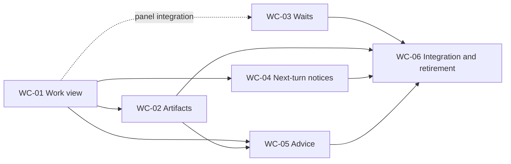

# Work coordination implementation plan

Status: implementation contract recorded on 2026-11-05. Planning baseline
`48ddbdcfb999e770f5147be3b3b6b71ccfd7fb8e`. See
[implementation status](../implementation-status.md) for delivered source and the
[operator guide](../operator/work-coordination.md) for current commands.
The [design](work-coordination-design.md) defines the selected contracts, domain
terms, limits, interfaces and recovery rules. This plan implements all five
features without an experiment or candidate-selection phase.

## Delivery contract

Each numbered slice below delivers a complete user workflow through storage,
CLI/API, relevant UI/native integration, failure handling, documentation and
local checks. Internal schema or helper commits may precede the final slice
commit, but the feature is not enabled or reported delivered until its complete
acceptance criteria pass. No production milestone consists only of a schema,
unused abstraction, shadow model worker or nonfunctional button.

Routine design choices are resolved in the design. No owner interview or live
provider quality study blocks implementation. Correctness, privacy, subscription
routing and supported native integration are required verification, not optional
experiments. The new behavior should be useful as shipped and removable through
its documented retirement path.

## Sequence and dependencies

| Step | Complete outcome | Required predecessor | Feature coverage |
| --- | --- | --- | --- |
| WC-01 | Inspect a real project's work and maintain explicit execution/progress associations through CLI and browser | None | 1: shared work view |
| WC-02 | Register exact artifacts, link them to work, and navigate reverse impact | WC-01 | 3: task–artifact graph |
| WC-03 | Register a wait, end a turn, and receive its durable result/timeout notice | None for Store/CLI; WC-01 for work-view panel | 2: durable waits |
| WC-04 | Queue a quiet notice and handle up to three on the next supported user turn, with inspect/flush/expiry | WC-01 for panel; existing native notice infrastructure | 4: next-turn notices |
| WC-05 | Generate, review, apply, reject and undo coordination advice with a real subscription adapter | WC-01 and WC-02 | 5: model-assisted coordination |
| WC-06 | Verify the combined user journey, recovery and feature retirement; publish final install/runbook | WC-01 through WC-05 | Cross-feature release |

WC-01 goes first because it supplies stable external work identity, explicit
attribution and the navigation surface needed by three other features. WC-03
can be developed independently while WC-01 is in progress, with its UI integration
completed after WC-01. WC-02 and WC-04 can proceed in parallel after WC-01.
WC-05 can then proceed while final native verification finishes.

Use isolated `git-wt` worktrees. One integrator allocates migration numbers at
landing time and coordinates changes to shared operation/restore code. Land
verified slices through `git-land`, push main, and remove each worktree/branch.
A parallel branch must rebase and rerun its required checks after a conflicting
shared-contract change.

The earlier CAIRN-276–278 journal ownership work remains a separate structural
campaign. WC-04 must use the current journal owner interface at implementation
time and coordinate overlapping lifecycle edits; these feature plans do not
silently enlarge those tickets. CAIRN-274 and CAIRN-275 retain their existing
investigation scope. The implementation items below cover this separate feature
campaign.

## Plane work items

The six slices have separate implementation items in the work instance's Cairn
project. Each item was read back after creation with its scope, acceptance checks
and stable external identity verified. Creating these items does not establish
implementation acceptance.

| Plan slice | Plane item | Prerequisites |
| --- | --- | --- |
| WC-01 | [CAIRN-279](https://proximal.tail0ecc2e.ts.net:10000/proximal/projects/afa5d2cc-95d4-4377-8cea-769f6b479c84/issues/2431dc31-34f1-4605-90ed-03e2f59a93bf/) | None |
| WC-02 | [CAIRN-280](https://proximal.tail0ecc2e.ts.net:10000/proximal/projects/afa5d2cc-95d4-4377-8cea-769f6b479c84/issues/4b1c9a95-fd1a-43e3-96bd-53811b6f5c32/) | CAIRN-279 |
| WC-03 | [CAIRN-281](https://proximal.tail0ecc2e.ts.net:10000/proximal/projects/afa5d2cc-95d4-4377-8cea-769f6b479c84/issues/71d2d798-564e-417a-bda1-6cb4b0e65c85/) | CAIRN-279 for the work-view panel |
| WC-04 | [CAIRN-282](https://proximal.tail0ecc2e.ts.net:10000/proximal/projects/afa5d2cc-95d4-4377-8cea-769f6b479c84/issues/f3aa8aff-d1c2-485c-b9d5-683d0cf174d3/) | CAIRN-279 |
| WC-05 | [CAIRN-283](https://proximal.tail0ecc2e.ts.net:10000/proximal/projects/afa5d2cc-95d4-4377-8cea-769f6b479c84/issues/faed6088-67b9-44c6-96a2-89b92380760e/) | CAIRN-279, CAIRN-280 |
| WC-06 | [CAIRN-284](https://proximal.tail0ecc2e.ts.net:10000/proximal/projects/afa5d2cc-95d4-4377-8cea-769f6b479c84/issues/c738e872-9fba-4d9d-a202-12c2bc64976e/) | CAIRN-279, CAIRN-280, CAIRN-281, CAIRN-282, CAIRN-283 |

The item bodies retain these dependencies. Native blocking relations are not
available through the installed CLI or this session's tools, so no native
blocking edges are claimed. WC-03 Store/CLI development can proceed before
WC-01; the panel remains a completion dependency. No parent was specified.
The creation identity is `external_source: cairn-work-coordination`, with
`external_id: cairn-wc01-v1` through `cairn-wc06-v1` in slice order.

## WC-01 — A usable work view with explicit associations

**Outcome.** Configure one Plane project, refresh its cards, associate exact
sessions/requests/results, add selected progress or blocker annotations, and
inspect the result through a readable CLI and protected local browser. No
operation changes Plane task state or wakes a worker.

**Implementation scope.** Add the private WorkProjection Store module and additive
project/item/snapshot/association/annotation tables. Implement the allowlisted
read-only Plane CLI connector outside transactions, bounded refresh staging and
atomic cache swap. Extend the operation catalog/refusal definitions, `cmd/cairn`
work commands, and embedded work-view presentation module. Use existing directory,
event, response-group and run interfaces for target validation and current reads;
do not call the notification-producing branches of coordination review.

Deliver project add/show/disable, refresh, list/show, associate/unassociate,
progress add/edit, blocker add/resolve, metadata purge/exclude and serve together.
Local browser writes are limited to those operator metadata operations, with
launch-session/Origin/CSRF protection. No arbitrary API proxy or artifact execution
is exposed. Use the OS operator Store channel and a dedicated loopback work server;
ordinary agent API profiles, including local-destination profiles, cannot invoke
operator work operations. CLI JSON and browser render the same structured view.

Include feature admission/status controls, Store runtime compatibility floor and
restore-aware cache invalidation in this slice. Define all new data in deletion
and recovery inventories before enabling its writes. Add proposed work terms to
the existing glossary; document the configuration and user workflow in current
guides only when implemented.

**Acceptance.**

- Two projects with the same display identifier remain distinct by external UUID
  tuple; a collection or workspace path cannot retarget a project.
- Repointing a configured Plane instance cannot retarget an existing binding's
  pinned origin/workspace/project. Refresh refuses the changed configuration.
- One item linked to two executions shows both. Resume leaves the old link
  historical until a new explicit association is made, without borrowing the new
  execution's overwritten task summary.
- Ordinary local-destination agent and observer profiles cannot invoke operator
  work mutations or advice apply.
- A linked request displays pending, leased and handled separately from Plane
  state and selected progress. Missing/forgotten payloads stay unavailable.
- A successful full refresh replaces one cache generation; older responses,
  partial lists and network errors cannot overwrite it as a complete result.
  Auth rejection hides formerly cached external fields.
- Duplicate mutations return the retained response; changed UUID intent and
  expected-version conflicts refuse without partial writes.
- Refresh fixtures reject every mutating Plane command. Viewing changes no
  presence, lease, delivery, notification or external task state.
- Purge removes known text copies and retry payloads; exclusion prevents refresh
  resurrection and is reapplied during a disposable restore.
- A deterministic barrier between refresh staging and import proves that a
  concurrent purge/exclusion wins over stale staged metadata and advice results.
- UI supports long/untrusted titles, empty projects, unavailable sources,
  stale/failing refreshes, filters and pagination on desktop/mobile. Local browser
  credentials stay out of page source, logs and URLs; cross-origin writes refuse.

**Verification.** Run disposable Store integration, actual CLI/API requests against
that fixture, a scripted Plane executable with successful/partial/error responses,
contract generation checks and UIPass on the local UI fixture. Inspect screenshots
in addition to the mechanical verdict. Run `make check`, `make test-integration`,
`make test-lifecycle` for new restore interactions, and the documentation checker.

**Rollout/recovery.** Stop incompatible readers/writers, migrate, install the
compatible disabled build and configure the existing Plane profile. Enable one
binding, perform a real read-only refresh, and verify CLI/browser without task
mutations. To retreat, stop refresh/browser and disable new work metadata writes;
preserve additive tables, exclusions and compatible purge/recovery readers.

## WC-02 — Exact artifact links and reverse impact

**Outcome.** Register a commit, report, CI run or exact Cairn result, link its
revision to several items, and answer which visible items reference that revision.

**Implementation scope.** Add artifact identity, immutable revision and attributed
link tables. Implement register/show/link/unlink/impact through Store, CLI/API and
work/artifact detail views. Use the four kinds and locator rules in the design;
no local-file custody, crawler, mutable-branch identity or generic relation engine.
Add source currentness and purge integration. Keep source-derived metadata and
link history from surviving a privacy change as an alternate readable copy.

**Acceptance.**

- Many items can link to one revision and one item to many revisions with
  independent input/output/evidence roles; exact duplicate links retry safely.
- Registering a newer revision does not alter prior links, provenance or task
  state. Mutable/unverified report locators are labelled as such.
- Reverse lookup paginates all visible matches and exposes source timestamps.
  A digest, basename or item display ID cannot merge unrelated identities.
- A source becoming unavailable masks its referenced data; unlink and purge have
  distinct effects and neither deletes the external artifact.
- Malicious schemes, credential-bearing URLs, invalid object IDs and unknown
  source revisions refuse atomically. No registration fetches URLs, runs hooks,
  executes content or edits Plane.
- CLI and browser can add/remove links, inspect attribution and navigate impact
  with empty, unavailable and historical revisions displayed accurately.

**Verification.** Disposable Store/API/CLI tests, locator validation, mutation
retries and deletion/restore fixtures; UIPass for work/artifact pages;
`make check`, `make test-integration`, relevant lifecycle checks and docs checks.

**Rollout/recovery.** Additive migration and compatible reader deployment, then
artifact admission. Disable registration/linking to retreat. Keep existing links
inspectable and purgeable; disable advice actions that depend on removed kinds.
No external file, report or task rollback is performed.

## WC-03 — Durable waits through actual notification delivery

**Outcome.** An agent registers a supported wait and ends its turn. It receives
one durable notice after an eligible response/group closure or deadline; get/list
and cancel work throughout. The work view shows dependency and delivery state.

**Implementation scope.** Add wait and notification-outbox tables, both predicates,
owner/session validation with retained destination/ceiling and binding revalidation,
idempotent registration with retained-state evaluation,
nonblocking CLI/API and operator inspection. Integrate resolution into response
publication/group closure and the bounded scheduler sweep; use database time and
stable lock ordering. Compose source creation, reserved notice publication and
outbox completion inside one private Store transaction under the scheduler's
actual identity. Do not impersonate the waiter or introduce a general workflow
language. Deliver work-view wait panel before reporting the feature complete.

Include generation fencing of waiting/outbox state and affected notification
capabilities, compatibility checks, maintenance controls, pending counts and
retirement commands in this slice. No rollout of registrations without a working
resolver and notifier.

**Acceptance.**

- Response/closure before registration satisfies from retained state; a concurrent
  registration/publication loses no notification. Both absent and present
  correlation are checked exactly; handling alone does not satisfy a wait.
- A first qualifying failure report is a response without becoming task success.
  Wrong responder, target, dependency owner or unavailable source refuses/is
  restricted according to the design.
- Deadline, cancellation and closure races have one documented winner; a timely
  retained event is not converted into timeout by scheduler downtime.
- Crash between resolution and outbox processing recovers to one notice. Crash
  after publication/lost response does not allocate a second source/event.
- A real disposable native recipient reads and acknowledges the exact generated
  notice. Acknowledgment, wait satisfaction and original task outcome are distinct.
- Legitimate conversation resume can inspect/cancel; stale execution cannot.
  Offline recipients remain addressed without starting a replacement session.
- Restore of waiting, resolved-unpublished and published-unacknowledged cases
  does not automatically repeat a continuation; state remains inspectable.
- Restore a published, unclaimed notice, then legitimately resume the recipient;
  generic polling and native readiness both honor its persistent admission fence.
- A revoked binding or widened successor profile cannot expose a result beyond
  the wait's original authenticated destination and sensitivity ceiling.
- Disabling new registration continues maintenance of accepted work. A pure get
  reports overdue state without claiming it has persisted timeout.

**Verification.** Deterministic transaction barriers, fault injection at transaction/
notification seams, actual scheduler/CLI/API against disposable PostgreSQL, native
host delivery fixture, `make test-integration`, `make check`, `make test-lifecycle`
and updated docs/contract checks. No polling loop in a model is required to prove
that the feature works.

**Rollout/recovery.** Deploy compatible Store/API/scheduler/clients with admission
disabled, migrate and verify sweep readiness, then enable waits. To remove the
feature, disable creation and either finish accepted waits or explicitly cancel
still-waiting rows. Preserve and reconcile terminal notification work; never drop
an outbox or restore an old database merely to remove this feature.

## WC-04 — Quiet notices through supported native user turns

**Outcome.** Publish an optional update with expiry, observe it queued without
waking the recipient, then handle it during the next supported user turn. Up to
three items can advance after explicit per-item settlement; the remaining queue,
expiry and explicit publisher flush are visible.

**Implementation scope.** Add the versioned delivery policy and separate admission
queue, queue/status read, bounded expiry worker and publisher flush into normal
delivery. Extend native host claim/advance with stable origin observation, persisted
Store-owned per-turn root/cutoff, budget and null decisions, unique across retries
with new request IDs. Tag attempts with admission kind/root; reject unrelated
attempts during advance. Materialize one delivery at a time atomically with
its nonexclusive attempt; never make the whole quiet backlog generically claimable.

Deliver the initial native workflow through a verified patched Codex 0.166 local
TUI and the existing `scripts/launch-codex-coordination.py` route: `--remote
unix://SOCKET` connects to the launcher's own app-server. Extend that route with
per-launch inherited-FD proof authenticating the owner TUI connection. Combine
the actual composer submission marker with Core's fresh-start versus
joined/recovery observation to produce versioned hook provenance. Public RPC
client labels or claimed source cannot grant owner origin. An embedded-only
path does not satisfy this deliverable.

Pin the advertised capability to the verified native contract/build, launcher
and complete installed lifecycle bundle. The native slice supplies the patch,
contract and verification evidence; its planned reference is
`docs/native-owner-origin.md`. Unpatched Codex, Claude 2.1.318, OpenCode, Hermes
and Agy refuse `UNSUPPORTED_DELIVERY` before publication. Include old/new
capability behavior and the work-view queue panel. Reuse the current journal
owner after any CAIRN-276–278 integration.

This 2026-11-05 scope correction replaces the original four-runtime promise
because native-boundary review did not establish the required owner-origin
contract for those runtimes. All five features remain required; WC-04 delivers
its complete publish/queue/next-turn/settle/inspect/flush/expiry/restore workflow
on the supported patched Codex binding.

**Acceptance.**

- Queued entries never appear as ready work to generic NextEvent, idle-wake
  watchers, cues, pool dispatch or existing normal native batch advancement.
- A new supported user-input turn can admit; a queue/channel message, repeated
  callback, background notification, compact/resume or joined wake-owned prompt
  cannot. Missing/ambiguous origin remains ineligible, never guessed.
- The launcher-owned local server authenticates the TUI connection through its
  per-launch inherited-FD proof. Public RPC labels/source fields and copied
  composer markers on other connections cannot admit. Native build/contract or
  lifecycle bundle mismatch removes support before publication.
- Root admission, including none, is stable across retries. Later arrivals do
  not join the burst. Every advance requires settlement and rechecks priority;
  at most three quiet notices materialize in one root turn.
- Source reads respect current eligibility and context budget. Rendering is not
  acknowledgment; a notice cannot cancel the shared owner turn.
- Claim/flush/expiry races create at most one ordinary delivery. Overflow rejects
  the new publication without discarding earlier work.
- A crash after admission/before render preserves the exact hold; it does not
  requeue or wake another turn. Existing journal replay and explicit outcomes
  remain correct under lost responses.
- Legitimate new execution can admit queued work for the same conversation;
  stale attempts cannot act on the new execution. Restore fences old-generation
  admission and does not replay queued updates automatically.
- Unsupported bindings refuse before acceptance; partial rolling upgrades do
  not silently downgrade delivery mode. Disable leaves queued work visible for
  publisher flush or expiry, without mass wakes.

**Verification.** Disposable Store races, actual adapter hook fixtures and a
patched Codex 0.166 local TUI run through the existing launcher and owned remote
server; exercise authentic composer input, joined/recovery paths and forged RPC
origin claims. Verify the pinned native contract/build and installed bundle,
including unsupported bindings and mismatch refusal. Use a native process/queue
fixture that counts turns and per-item outcomes; UI checks; `make test-integration`,
`make check`, `make test-lifecycle` and docs checks. Verify zero notice-induced
turns before explicit flush or independently initiated user input. Patch presence
or an embedded-only fixture does not establish launcher-path acceptance.

**Rollout/recovery.** Upgrade compatible server, scheduler and complete host bundles,
verify each binding's advertised origin capability, then enable publication.
Rollback stops publication/admission; compatible maintenance keeps queue inspection,
expiry and explicit flush. Reconcile materialized holds before host downgrade.
Additive queue state remains available until deliberately retired.

## WC-05 — Useful advice with review, atomic apply and undo

**Outcome.** Select a work item, generate suggestions through one configured
subscription route, inspect exact edits and sources, apply a chosen subset, reject
others, and undo an unchanged application. All three action types in the design
ship through CLI and Suggestions UI; an offline shadow score is not the feature.

**Implementation scope.** Add WorkAdvice jobs, immutable authorized snapshots,
actions, review revisions and application receipts. Implement operator field
sharing policy, bounded cleanup and source-forget dependencies. Add the complete
Codex subscription adapter with an exact executable/capability/configuration-home/
model registration, typed output, owned-process cleanup and no tools or alternate
routes. Do not import trial harness code or widen lesson proposals.

Implement a narrow native `cairn-advice` command against pinned Codex source,
packaged independently of the owner-input TUI patch. Use native authentication
and Responses interfaces directly, require the exact ChatGPT subscription
authentication variant, and freeze the built-in provider, validated destination
and explicit model before one generation request. Honor native policy; refuse
incompatible routes before sending input. Disable tools, the agent loop,
generation retries and repair. The installed Claude settings preflight does not
freeze dynamic managed policy and is no longer the selected adapter.

Validate the `cairn.codex-advice-result/1` envelope, request UUID, route and model
plus successful process exit, then parse its string `result` as exactly one
proposal object under the strict application schema. Malformed output refuses
without repair or another model invocation. Verify the native implementation's
route lock and one-request behavior with deterministic transport tests before
the real subscription smoke.

Implement generation/list/show/apply/reject/undo through private transaction helpers
for existing work annotations/links. Render before/after changes, attribution,
expiry and stale/purged reasons in CLI and UI. Feature controls independently
disable generation and apply while preserving cleanup and retained outcome reads.

**Acceptance.**

- One real configured subscription invocation produces a retained reviewable
  result; the operator can complete all three allowed edit types and undo an
  unchanged application. A valid no-suggestions response is also a complete result.
- Deterministic provider fixtures prove unknown IDs/actions, malformed output,
  proposed arbitrary URLs, tool requests and oversize data cause no operational
  mutation or fetch.
- Native terminal-result fixtures cover process failure, error envelopes,
  unexpected envelopes, malformed `result` JSON, extra text and unknown proposal
  fields.
  Each output refusal follows exactly one invocation, with no repair/rerun.
  Native transport fixtures prove one generation request, no tools or fallback,
  exact subscription authentication and refusal of alternate routes before input.
- Explicit source selection cannot bypass hosted eligibility; local inputs refuse
  before launch. Currentness/expiry/source privacy/execution replacement/restore
  invalidate apply, including known copied text under forgetting.
- Subset apply is atomic; one conflicting action leaves all selected actions
  unapplied. Lost response returns the original receipt on identical retry.
  Unselected actions stay pending, rejection changes no work metadata, and undo
  refuses intervening edits.
- Undo of blocker creation withdraws that annotation; undo of blocker resolution
  reopens its prior state with a new revision. Both reject intervening edits.
- Quota/auth failure stops the operation without another provider/account/model.
  Unrecognized profile/capability, incompatible effective policy or a changed
  executable refuses before use.
- Timeout, output overflow and cancellation terminate and verify the owned process
  group; restart reconciles uncertain execution without another model invocation.
  A late result cannot bypass expiry or create a second application.
- Input/output/retention limits, job dedupe, per-profile admission and purge cleanup
  work with generation disabled. Empty/stale/expired/purged UI states are actionable.

**Verification.** Full CLI/API/Store workflow against disposable PostgreSQL and a
scripted streaming provider process; deterministic concurrency/deletion/restore
cases; one bounded live subscription smoke for the real adapter with selected
shareable fixture data, subject to the existing auth/quota stop policy. UIPass
and screenshot inspection for Suggestions. Run `make test-integration`,
`make check`, relevant lifecycle/driver tests and docs checks. Model output quality
is not substituted for evidence that authorization and apply/undo work correctly.

**Rollout/recovery.** Register the existing subscription profile without creating
credentials, declare exactly allowed input fields and enable generation/apply.
Disable generation to remove model cost immediately. Reject/expire pending advice
or disable apply; keep cleanup. Undo applied annotations/links only through guarded
compensation. No Plane rollback or automatic provider rerun is needed.

## WC-06 — Combined release and retirement verification

**Outcome.** One documented campaign can use all five features, and each can be
disabled or retired without losing accepted work or reviving deleted data.
This is final integration work, not a second feature project needed to make the
previous slices useful.

Use a disposable project with two exact sessions, a Plane card fixture and a
registered report/commit. Associate both executions, exchange a request and group
responses, register waits, queue next-turn notices, and apply/undo a supported
advice action. Confirm the work view distinguishes external task state, selected
annotations, delivery and artifact provenance throughout.

Inject restart and restore at wait-outbox, organic-admission and advice-launch
points. Disable features in reverse dependency order. Verify accepted work stays
inspectable, remaining maintenance completes or explicitly fences it, old binaries
cannot operate against enabled incompatible state, and no request/session is
recreated to bypass a failed context. Perform metadata purge and restore-reapplication
with cached advice and artifact references before final acceptance.

Run the required checks once on the integrated revision, rerunning only when new
changes/failures justify it. Update feature references, CLI/API capability docs,
operator deployment/retirement runbook, current implementation status and glossary.
Record installed versus source-only status separately. Keep full design acceptance
and measured usefulness distinct from successful checks.

## Definition of done and verification performed for this plan

Implementation completion requires every slice's observable workflow, compatibility
contract, tests, docs and retirement path. A green unit suite alone cannot satisfy
native delivery, PostgreSQL races or process cleanup. No TODO stub, unimplemented
provider option, permissive fallback or permanently disabled advertised button is
an accepted substitute.

The original planning commit added documentation only. Its design review checked
the source seams and the installed subscription CLI controls. It made no model
request or live service change and implemented no feature. Documentation validation
and `make check` are recorded with that commit. The checks above define acceptance;
they are not execution results merely because they appear in this plan. Current
source behavior and its limits are recorded in the linked implementation status
and operator guide.
